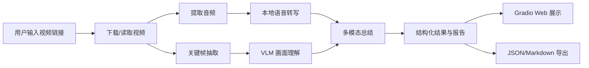
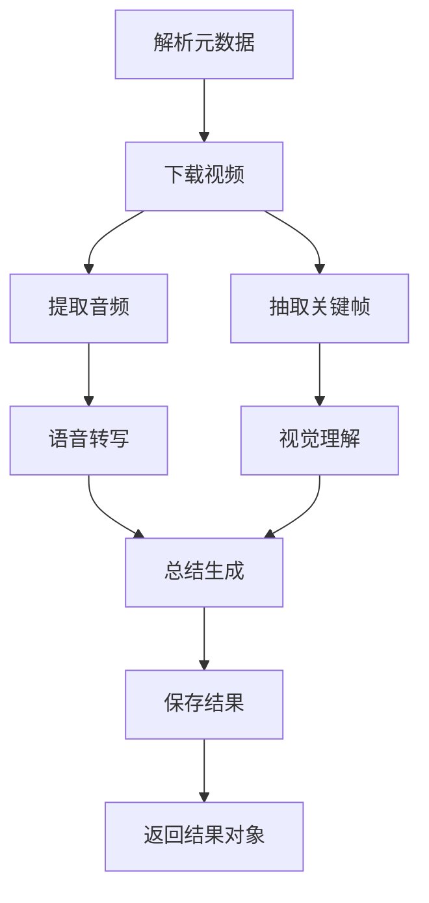

# VideoLens 视频链接智能总结系统——项目分析与设计文档

## 1. 总体分析

### 1.1 问题分析

视频理解系统的难点包括：

1. 视频 token 数量大，不能简单地把所有帧输入模型；
2. 视频同时包含语音和画面，需要多模态融合；
3. 用户输入通常只是一个链接，系统必须自动完成下载和预处理；
4. 现场演示要求流程稳定、界面直观、错误可恢复。

### 1.2 设计思路

借鉴视频多模态调研中的关键思想，本项目采用以下原则：

| 调研结论 | 项目落地方式 |
|----------|--------------|
| 视频 token 应高效压缩 | 关键帧采样 + 最大帧数限制 |
| 运动剧烈片段比静止片段更重要 | 场景变化检测补充关键帧 |
| 多模态 CoT 要保持模态原生性 | 语音文本和画面描述分别保留 |
| 工具/检索能力可用工程规则近似 | “先粗看，再按需理解关键帧” |
| 小模型和工程化同样有应用价值 | 本地 Whisper + 可选云端 VLM |

### 1.3 技术路线选择

| 决策点 | 方案 A | 方案 B | 本项目选择 |
|--------|--------|--------|------------|
| 语音转写 | 云端 Whisper API | 本地 faster-whisper | 本地，隐私好、可离线演示 |
| 视觉理解 | 自训 4B 多模态模型 | OpenAI-compatible API | API，低成本、易配置 |
| 关键帧 | 固定均匀采样 | 场景检测 + 均匀采样 | 两者结合 |
| 总结 | 规则模板 | LLM 融合 | LLM 优先，规则回退 |
| 界面 | 命令行 | Gradio Web | Gradio，适合现场展示 |

## 2. 系统总体架构



### 2.1 分层架构

| 层次 | 模块 | 职责 |
|------|------|------|
| 展示层 | Gradio UI | 接收链接、展示结果 |
| 业务编排层 | Pipeline | 串联完整分析流程 |
| 能力层 | Downloader、Media、Transcriber、Keyframes、VLM、Summarizer | 单项处理能力 |
| 数据层 | Storage | 文件与 JSON 保存 |
| 配置层 | Config | 统一读取环境变量 |

## 3. 模块设计

### 3.1 config 模块

职责：读取 `.env` 和系统环境变量，初始化目录。

关键配置：

- `OPENAI_API_KEY`、`OPENAI_BASE_URL`
- `VLM_MODEL`、`LLM_MODEL`
- `ASR_MODEL`、`ASR_DEVICE`
- `FRAME_INTERVAL`、`MAX_FRAMES`
- `VIDEO_DIR`、`OUTPUT_DIR`

### 3.2 downloader 模块

职责：解析链接、获取元数据、下载视频。

主要流程：

1. 判断输入是否为本地文件；
2. 调用 `yt-dlp` 提取标题、时长、视频 ID；
3. 使用 MP4 格式模板下载；
4. 在输出目录中定位最终视频文件；
5. 失败时抛出包含可读信息的 `DownloadError`。

### 3.3 media 模块

职责：使用 FFmpeg 探测时长、提取音频。

音频参数：

- 单声道；
- 16kHz 采样率；
- WAV 格式，便于 Whisper 读取。

### 3.4 transcriber 模块

职责：调用 `faster-whisper` 转写音频。

设计要点：

- 启用 VAD 过滤静音；
- 输出片段包含 `start`、`end`、`text`；
- CPU 使用 `int8` 量化，GPU 可用 `float16`；
- 保留原始文本，不提前压缩，保证后续总结信息完整。

### 3.5 keyframes 模块

职责：从视频中抽取代表性画面。

算法设计：

1. 读取 FPS 和总帧数；
2. 生成均匀采样时间点；
3. 对中等长度视频，每隔固定时间扫描一帧，计算灰度直方图相关性；
4. 相关性低于阈值时认为场景变化，加入候选关键帧；
5. 合并均匀帧与场景帧，按时间排序，并限制最大数量；
6. 保存 JPEG，文件名包含时间戳。

该设计借鉴 OneVision-2 的“运动剧烈片段优先”思想，但用简单视觉特征实现，不依赖编解码器。

### 3.6 vlm 模块

职责：调用 VLM 理解关键帧，并调用 LLM 生成总结。

关键帧理解 Prompt 要求模型输出：

- 时间戳；
- 画面描述；
- 主要对象；
- 动作或事件；
- 与视频主题可能相关的高亮信息。

为降低 API 调用次数，可将多张关键帧合并为一次请求。

### 3.7 summarizer 模块

职责：融合语音文本和画面描述。

LLM 路径 Prompt 输入：

- 视频标题；
- 视频时长；
- 逐句转写；
- 关键帧画面描述。

输出 Markdown 结构：

- 一句话总结；
- 核心内容；
- 时间线；
- 关键结论；
- 关键词；
- 标签；
- 适合人群。

规则回退路径：

- 使用 `jieba` 提取关键词；
- 按时段分组转写，构建时间线；
- 取信息量较高的句子作为核心要点；
- 根据关键词映射标签和适合人群。

### 3.8 storage 模块

职责：保存结果。

输出结构：

```text
data/output/<job_id>/
├── result.json
├── summary.md
├── transcript.json
├── captions.json
└── keyframes/
```

### 3.9 pipeline 模块

职责：编排各能力模块，并对外提供阶段回调。

分析流程：



容错设计：

- 音频提取失败 → 转写为空，继续画面理解和总结；
- VLM 调用失败 → 画面描述为空，总结只依赖转写；
- LLM 调用失败 → 使用规则总结；
- 下载失败 → 终止任务并返回明确错误。

## 4. 数据结构设计

### 4.1 TranscriptSegment

| 字段 | 类型 | 说明 |
|------|------|------|
| start | float | 开始时间，秒 |
| end | float | 结束时间，秒 |
| text | str | 转写文本 |

### 4.2 Keyframe

| 字段 | 类型 | 说明 |
|------|------|------|
| path | str | 图片路径 |
| timestamp | float | 时间戳，秒 |
| scene_score | float | 场景变化得分，可选 |

### 4.3 SceneCaption

| 字段 | 类型 | 说明 |
|------|------|------|
| timestamp | float | 时间戳，秒 |
| description | str | 画面描述 |
| objects | list[str] | 主要对象 |
| action | str | 动作或事件 |

### 4.4 SummaryResult

| 字段 | 类型 | 说明 |
|------|------|------|
| title | str | 视频标题 |
| one_sentence | str | 一句话总结 |
| core_points | list[str] | 核心要点 |
| timeline | list[dict] | 时间线 |
| keywords | list[str] | 关键词 |
| tags | list[str] | 标签 |
| audience | str | 适合人群 |
| markdown | str | 完整报告 |

## 5. 接口设计

### 5.1 核心函数

| 函数 | 输入 | 输出 |
|------|------|------|
| `download_video` | URL、输出目录 | 视频路径 |
| `extract_audio` | 视频路径、输出目录 | 音频路径 |
| `transcribe` | 音频路径 | 转写片段列表 |
| `extract_keyframes` | 视频路径、输出目录 | 关键帧列表 |
| `caption_keyframes` | 关键帧列表 | 画面描述列表 |
| `build_summary` | 元数据、转写、画面描述 | 总结结果 |
| `analyze_url` | URL、进度回调 | 完整结果字典 |

### 5.2 对外输出

`analyze_url` 返回字典，包含：

- `job_id`；
- `metadata`；
- `video_path`；
- `audio_path`；
- `transcript`；
- `keyframes`；
- `captions`；
- `summary`；
- `output_dir`。

## 6. 关键算法设计

### 6.1 场景变化检测

对抽样帧计算灰度直方图，使用相关性系数：

```text
corr = cv2.compareHist(hist_prev, hist_curr, cv2.HISTCMP_CORREL)
```

当 `corr < SCENE_THRESHOLD` 时，认为场景发生变化。

该算法简单、计算量低，适合课程作业和现场演示。

### 6.2 关键帧数量控制

```text
候选帧 = 均匀采样帧 ∪ 场景变化帧
最终帧 = 按时间排序后取前 MAX_FRAMES 帧
```

同时保证首帧和末帧尽量被保留，避免遗漏开头和结尾信息。

### 6.3 多模态总结

```text
输入：
  标题、时长、转写文本、画面描述

处理：
  1. 截断超长文本
  2. 组装结构化 Prompt
  3. 调用 LLM 生成 Markdown

输出：
  可读总结 + 结构化字段
```

### 6.4 无 API 回退

当 `OPENAI_API_KEY` 为空或 LLM 调用失败：

1. 按时段合并转写片段；
2. 每个时段取首个有意义的句子作为时间线；
3. 使用 `jieba.analyse.extract_tags` 提取关键词；
4. 基于关键词映射标签和适合人群；
5. 拼接 Markdown。

## 7. 测试计划

### 7.1 单元测试

- 配置加载；
- 时间格式化；
- 关键帧数量上限；
- 总结回退逻辑；
- JSON 解析容错。

### 7.2 集成测试

- 本地短视频完整流程；
- 缺失音频时的降级流程；
- 未配置 API 时的降级流程；
- API 返回非法 JSON 时的容错流程。

### 7.3 演示验收

- 输入链接；
- 成功下载；
- 成功转写；
- 成功生成关键帧；
- 成功生成总结；
- Web 页面完整展示。

## 8. 部署与运行环境

- 操作系统：Windows 10/11、macOS、Linux 均可；
- Python：3.10+；
- FFmpeg：加入 PATH；
- 内存：建议 8GB 以上；
- 网络：需要访问视频站点和大模型 API。

## 9. 迭代计划

| 阶段 | 内容 | 交付物 |
|------|------|--------|
| 第一阶段 | 下载、音频、转写 | 可转写任意可下载视频 |
| 第二阶段 | 关键帧和视觉理解 | 输出画面描述 |
| 第三阶段 | 多模态总结和 Web 界面 | 可现场演示 |
| 第四阶段 | 导出、日志、容错优化 | 完整项目 |

## 10. 可扩展方向

- 增加“视频问答”：用户可对视频内容提问；
- 增加“按需回看”：参考 Video-MTR/VITAL，先粗看后检索相关片段；
- 增加流式监控：摄像头或直播流实时事件检测；
- 增加端侧部署：使用 MiniCPM-V 4.6 替代云端 VLM；
- 增加多视频对比：批量分析多个视频并横向比较。

