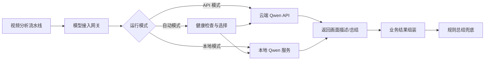
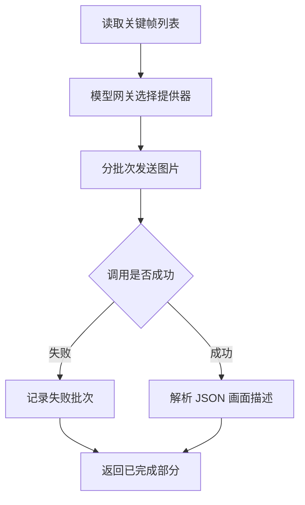
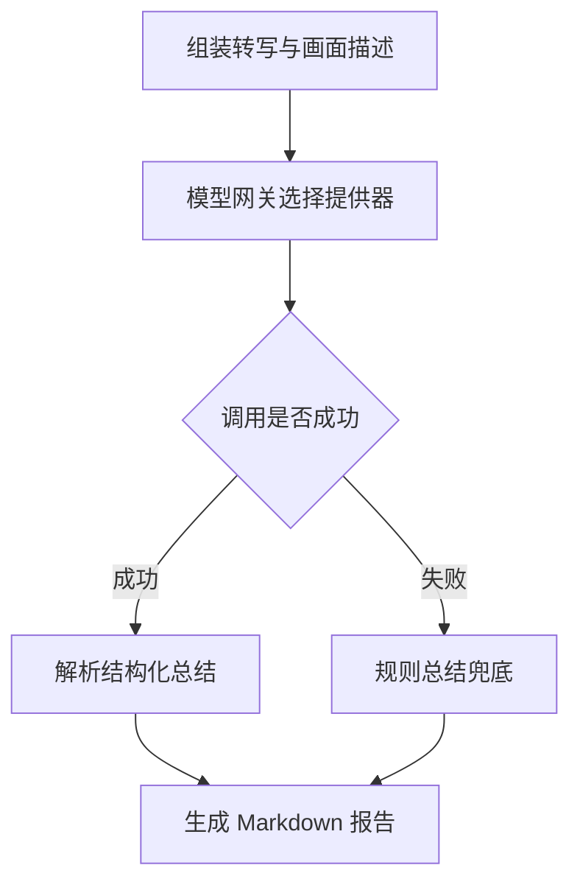
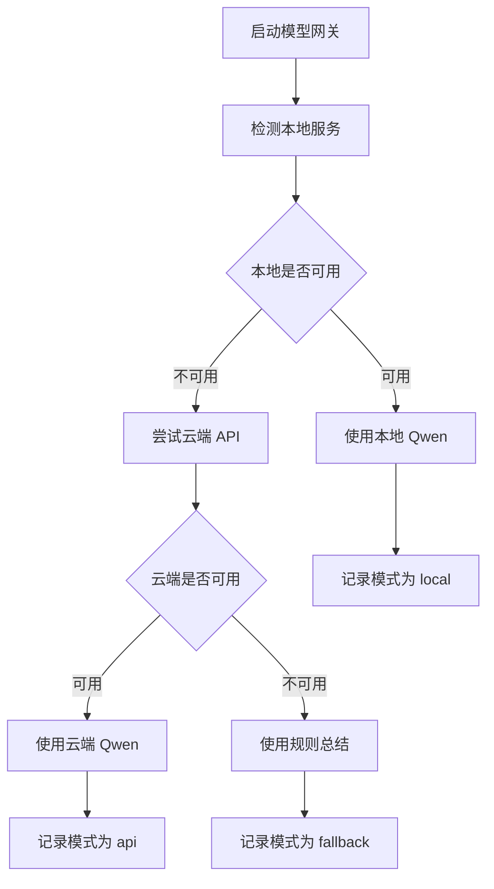
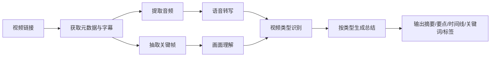
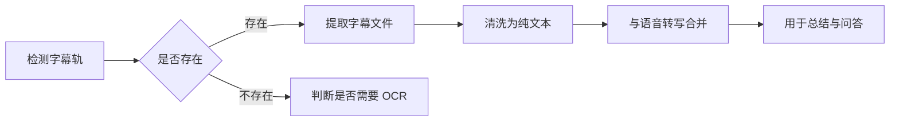
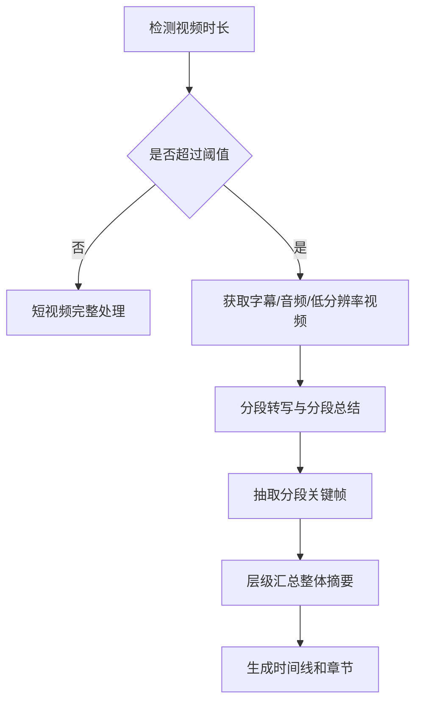

# VideoLens 双模式大模型接入设计报告

## 1. 设计目标

为 VideoLens 视频链接智能总结系统设计一套可切换的大模型接入方案，使系统既可以使用云端 Qwen API，也可以使用本地部署的 Qwen 小模型，并能在两种模式之间自动降级。

核心目标：

1. 用户不需要修改业务代码，只修改配置即可切换模式；
2. 本地模式和云端模式使用同一套业务接口；
3. 单点故障不影响主流程，最终可回退到规则总结；
4. 适合课程现场演示，兼顾稳定性、成本和可展示性。

## 2. 设计原则

- **接口统一**：视觉理解和文本总结都通过统一的模型提供器调用。
- **模式透明**：上层业务不关心底层是 API 还是本地服务。
- **优先本地，失败兜底**：默认尝试本地服务，本地不可用时切换云端 API，云端也不可用时回退规则总结。
- **配置驱动**：所有地址、模型名、密钥、超时时间集中在环境变量中。
- **无侵入改造**：现有下载、转写、抽帧流程保持不变。

## 3. 总体架构



### 3.1 核心分层

| 层 | 模块 | 说明 |
|----|------|------|
| 业务层 | 视频分析流水线 | 只依赖统一模型接口，不直接调用 OpenAI SDK |
| 接入层 | 模型接入网关 | 根据配置选择本地或云端服务 |
| 服务层 | 本地 Qwen / 云端 Qwen | 实际执行视觉理解和文本总结 |
| 兜底层 | 规则总结 | 模型完全不可用时生成基础报告 |

## 4. 运行模式设计

### 4.1 API 模式

系统调用云端 Qwen 服务，例如阿里云百炼 DashScope 提供的 OpenAI-compatible 接口。

特点：

- 需要配置 API Key；
- 对本地硬件要求低；
- 响应速度和成本取决于云服务；
- 适合没有独显的电脑或现场网络稳定时使用。

### 4.2 本地模式

系统调用本机部署的 Qwen 小模型服务。

可选部署方式：

| 方式 | 特点 | 适用场景 |
|------|------|----------|
| Ollama | 安装简单，模型管理方便，CPU/GPU 均可 | 课程演示、快速本地部署 |
| vLLM | 吞吐高，支持 OpenAI-compatible 接口 | 有 NVIDIA GPU，追求速度 |

本地模式需要部署两个能力：

- 视觉理解：Qwen-VL 小模型；
- 文本总结：Qwen 文本小模型。

特点：

- 不产生 API 调用费用；
- 视频画面和文本默认不上传云端；
- 对 GPU、内存有一定要求；
- CPU 模式下速度较慢。

### 4.3 自动模式

系统先检测本地服务是否可用，可用则使用本地；不可用则切换云端 API；云端也不可用时使用规则总结。

推荐现场演示使用自动模式，避免因某一种服务异常导致演示失败。

## 5. 模型接口设计

系统抽象出统一模型提供器，需要具备以下能力：

| 能力 | 输入 | 输出 | 说明 |
|------|------|------|------|
| 画面理解 | 关键帧图片列表 | 画面描述列表 | 每个关键帧给出时间戳、描述、对象和动作 |
| 文本总结 | 标题、时长、转写、画面描述 | 结构化总结 | 输出一句话总结、要点、时间线、关键词、标签等 |
| 健康检查 | 无 | 可用状态 | 用于自动模式判断本地服务是否在线 |

### 5.1 API 提供器

- 使用 OpenAI-compatible 客户端；
- 配置云端 Base URL、API Key、VLM 模型名和 LLM 模型名；
- 图片使用 Base64 Data URL 形式传给 VLM；
- 失败时抛出统一异常，由上层决定是否降级。

### 5.2 本地提供器

- 同样使用 OpenAI-compatible 客户端；
- Base URL 指向本地 `Ollama` 或 `vLLM` 服务；
- API Key 可留空或填写本地占位值；
- 模型名为本地服务注册的 Qwen 模型名；
- 支持较长超时，避免 CPU 推理被误判为失败。

### 5.3 模型网关

模型网关负责：

1. 读取运行模式；
2. 创建对应模型提供器；
3. 执行健康检查；
4. 调用模型服务；
5. 捕获异常并执行降级；
6. 记录当前实际使用的模式。

## 6. 配置项设计

### 6.1 模式选择

| 配置项 | 可选值 | 默认值 | 说明 |
|--------|--------|--------|------|
| `LLM_MODE` | `api`、`local`、`auto` | `auto` | 模型运行模式 |

### 6.2 云端 API 配置

| 配置项 | 说明 |
|--------|------|
| `API_BASE_URL` | 云端 OpenAI-compatible 接口地址 |
| `API_KEY` | 云端 API Key |
| `API_VLM_MODEL` | 云端视觉模型名 |
| `API_LLM_MODEL` | 云端文本总结模型名 |
| `API_TIMEOUT` | 云端请求超时时间 |
| `API_MAX_RETRIES` | 云端请求最大重试次数 |

### 6.3 本地服务配置

| 配置项 | 说明 |
|--------|------|
| `LOCAL_BASE_URL` | 本地 Ollama/vLLM 服务地址 |
| `LOCAL_VLM_MODEL` | 本地视觉模型名 |
| `LOCAL_LLM_MODEL` | 本地文本模型名 |
| `LOCAL_TIMEOUT` | 本地请求超时时间，建议大于云端 |
| `LOCAL_MAX_RETRIES` | 本地请求最大重试次数 |

### 6.4 降级策略配置

| 配置项 | 说明 |
|--------|------|
| `ENABLE_RULE_FALLBACK` | 是否允许最终回退规则总结 |
| `LOCAL_HEALTHCHECK` | 是否在自动模式下先检测本地服务 |

## 7. 调用流程设计

### 7.1 画面理解流程



设计要点：

- 关键帧分批处理，避免单次请求过大；
- 单批失败不影响其他批次；
- 返回结果中保留时间戳和图片路径，保证可溯源；
- 解析模型输出时使用容错解析，非法 JSON 不阻塞流程。

### 7.2 文本总结流程



### 7.3 自动模式流程



## 8. 降级与容错设计

| 故障场景 | 降级行为 |
|----------|----------|
| 本地服务未启动 | 自动模式切换到云端 API |
| 云端 API Key 无效 | 切换到规则总结 |
| 本地模型超时 | 尝试一次重试，仍失败则切云端 |
| VLM 返回非 JSON | 丢弃该批次结果，保留其他批次 |
| 转写为空且画面理解失败 | 输出基础信息总结 |
| 视频下载失败 | 终止任务，提示用户检查链接 |

## 9. 隐私与成本设计

### 9.1 隐私

- 本地模式下，视频画面和转写文本不发送到云端模型服务；
- API 模式下，画面描述请求会发送到云端，报告中应提示用户；
- API Key 仅从环境变量读取，不写入代码和输出文件；
- 临时视频分析完成后自动删除。

### 9.2 成本控制

- 关键帧数量设置上限；
- 本地模式无模型调用费用；
- 云端模式通过关键帧限制和文本截断控制 token 消耗；
- 可在分析前显示预计处理时间和调用次数。

## 10. 性能与资源估算

| 部署方式 | 硬件要求 | 20 张关键帧预计耗时 | 建议 |
|----------|----------|----------------------|------|
| 云端 Qwen API | 低 | 视网络和并发，通常较快 | 无独显时推荐 |
| Qwen-VL 3B int4，CPU | 内存 8GB 以上 | 较慢，可能数分钟 | 仅做本地验证 |
| Qwen-VL 3B，8GB GPU | 显存 8GB | 较快 | 演示可用 |
| Qwen-VL 7B int4，8GB GPU | 显存 8GB 以上 | 中等 | 质量更高 |

语音转写 `faster-whisper` 始终本地运行，不占用模型网关资源。

## 11. 测试设计

### 11.1 配置测试

- 分别验证 `api`、`local`、`auto` 三种模式能正确创建提供器；
- 验证错误配置能被识别并给出可读提示。

### 11.2 本地模式测试

- 本地服务正常时，能完成画面理解和总结；
- 本地服务关闭时，自动模式能正确切换云端。

### 11.3 API 模式测试

- 使用有效 API Key 时返回正常结果；
- 使用无效 API Key 时触发降级。

### 11.4 对比测试

- 同一视频分别使用本地模式和 API 模式，检查输出结构是否一致；
- 对比两种模式的关键词、时间线和总结质量。

### 11.5 现场验收

- 演示前分别跑通本地和云端两种模式；
- 现场优先使用自动模式；
- 准备一段已缓存的本地视频作为网络异常备份。

## 12. 与现有系统的关系

现有系统已经具备：

- 视频下载；
- 音频转写；
- 关键帧抽取；
- 画面描述；
- 总结生成；
- 结果导出。

双模式接入主要影响“画面描述”和“总结生成”两个环节，其他模块保持不变。改造后，系统获得三个能力：

1. 本地 Qwen 与云端 Qwen 可切换；
2. 模型故障时自动降级；
3. 现场演示可选择展示“完全本地推理”。

## 13. 功能扩展设计

### 13.1 默认视频总结

系统接收视频链接后，默认执行以下总结流程：



默认输出：

- 一句话总结；
- 核心内容要点；
- 带时间戳的时间线；
- 关键词和标签；
- 适合人群；
- 可下载的 Markdown/JSON 报告。

长视频需要对总结进行分层：先生成分段摘要，再汇总成整体摘要，避免一次性输入过长文本。

### 13.2 视频类型分析

系统在生成总结前，先对视频进行类型识别，再选择不同的总结模板。

建议类型：

| 类型 | 判断依据 | 输出重点 |
|------|----------|----------|
| 教程/课程 | 标题、教学用语、PPT 画面 | 知识点、操作步骤、章节结构 |
| 会议/讲座 | 多人对话、正式表达 | 议题、结论、待办事项 |
| 访谈/对话 | 一问一答、人物对话 | 观点、问答脉络 |
| 产品测评 | 商品名、对比词、实物画面 | 产品优点、缺点、对比结论 |
| 新闻资讯 | 时间地点、事件表述 | 事件要素、关键信息 |
| 影视剧情 | 对话、场景切换、剧情词 | 剧情梗概、人物关系 |
| 直播录屏 | 弹幕、口播、实时互动 | 直播主题、关键片段 |
| 其他 | 无法明确判断 | 通用总结 |

输出格式：

```text
视频类型：教程
置信度：0.92
判断理由：标题包含“入门教程”，画面以 PPT 和屏幕操作为主
推荐总结模板：教程型
```

类型识别输入包括：视频标题、时长、前若干条转写文本、关键帧画面描述。类型识别结果会影响后续总结 Prompt。

### 13.3 用户问答设计

用户可以在总结页面下方自由提问，系统根据已分析内容进行回答。

推荐采用两级问答机制：

#### 第一级：索引检索回答

适用问题：

- “视频讲了什么？”
- “第几分钟开始讲某个知识点？”
- “视频里提到了哪些结论？”
- “某段话在视频中的什么位置？”

处理方式：

1. 用户输入问题；
2. 对问题做意图识别；
3. 从转写片段、字幕、画面描述中检索相关证据；
4. Qwen 文本模型根据证据生成回答；
5. 回答附上时间戳、原文引用和关键帧。

#### 第二级：回到原始视频重看

适用问题：

- “第 3 分钟 PPT 上的图表是什么？”
- “视频里出现的那个产品是什么？”
- “这个画面中的人物做了什么？”

处理方式：

1. 模型判断需要回看的时间段；
2. 从临时视频中提取对应片段的音频和原始帧；
3. 使用 Whisper 或字幕获得局部文本；
4. 使用 Qwen-VL 重新理解局部画面；
5. 综合生成答案。

该能力只在临时视频尚未删除时可用，适合分析会话内使用。

### 13.4 字幕提取设计

对于有字幕的视频，字幕应作为高优先级信息来源。

#### 字幕来源一：内嵌或外部字幕轨

优先使用 `yt-dlp` 获取平台提供的字幕，或使用 FFmpeg 从视频容器中提取字幕轨。

支持格式：

- SRT；
- VTT；
- ASS/SSA；
- 其他可解析字幕格式。

处理流程：



字幕清洗需要去除：

- 时间轴；
- 样式标签；
- 重复行；
- 广告或无关水印文本。

#### 字幕来源二：烧录字幕 OCR

当字幕直接印在画面上，且没有独立字幕轨时，可使用 OCR 提取。

建议使用轻量 OCR 工具对关键帧底部区域进行识别。OCR 路径计算量大，应作为可选项，只在用户明确需要完整字幕时启用。

字幕的用途：

- 提高总结准确度；
- 减少 Whisper 转写错误；
- 提供精确到句的时间戳；
- 支撑用户问答中的原文引用；
- 可作为“完整字幕下载”功能输出。

## 14. 长视频处理策略

### 14.1 两小时电影或长课程

不能直接沿用短视频的全量处理方式，应采用“先轻量、后精细”的策略。

推荐流程：



关键设计：

- 优先下载音频和字幕，而不是完整高清视频；
- 若需要画面理解，下载低分辨率版本，例如 480p；
- 关键帧间隔增大，例如 30–60 秒抽一帧；
- 最大关键帧数量动态控制，避免成本爆炸；
- 对转写文本进行分段总结，再对分段摘要做二次总结；
- 用户可以选择只分析某个时间区间，而不是整部电影。

### 14.2 长视频下载速度问题

下载速度取决于视频站点、网络带宽、分辨率和视频时长，与程序本身关系较小。

缓解方案：

1. 选择低分辨率视频格式；
2. 优先下载音频和字幕；
3. 仅下载用户指定的时间段；
4. 使用直链时让 FFmpeg 直接处理网络流，减少本地完整文件；
5. 分析前显示预计文件大小和耗时；
6. 对超过设定时长的视频提示用户选择“短视频模式”或“分段模式”。

对课程作业来说，演示素材应控制在 5–10 分钟。两小时视频应作为“支持的能力”写入文档，而不是现场等待完整下载。

## 15. 小网站与非主流来源处理策略

### 15.1 三层输入通道

系统不能假设所有用户都来自 B 站、YouTube 等大型站点，因此设计三种输入方式：

| 输入方式 | 示例 | 处理方式 |
|----------|------|----------|
| 平台链接 | B 站、YouTube、抖音等 | 使用 yt-dlp 解析下载 |
| 直链媒体 | MP4、M3U8、FLV 等 | 使用 yt-dlp 或 FFmpeg 直接处理 |
| 本地文件 | 用户已有 MP4 | 直接读取，不需要下载 |

小网站无法解析时，用户可以粘贴页面中的真实视频直链，或先下载后上传本地文件。

### 15.2 小网站解析策略

优先尝试 yt-dlp。若失败，再考虑：

1. 从页面源码中提取 `<video>`、`<source>` 标签；
2. 从页面 JSON 数据中寻找视频地址；
3. 识别 M3U8 或 FLV 直链；
4. 必要时使用 Cookie、Referer、User-Agent 等请求头；
5. 对直播流使用 FFmpeg 直接拉流处理。

系统应给出明确错误提示：

- “该网站暂不支持自动解析”；
- “请粘贴视频直链”；
- “请下载后上传本地 MP4”。

## 16. 下载与临时存储策略

默认采用“临时下载、分析后清理”模式：

| 场景 | 下载内容 | 清理策略 |
|------|----------|----------|
| 短视频 | 完整低分辨率视频 | 会话结束后删除 |
| 长视频 | 音频、字幕、低分辨率视频或分段 | 会话结束后删除 |
| 用户上传 | 本地文件 | 不移动原文件，输出结果到输出目录 |
| 问答回看 | 临时视频片段 | 回答完成后删除片段 |

临时文件保存位置、最大占用空间和自动清理策略应可配置。系统可在分析结束后显示“视频已清理”的提示。

## 17. 后续可扩展方向

- 多视频批量比较；
- 摄像头/直播流的实时分析；
- 增加文本嵌入检索，支撑更准确的视频问答；
- 支持模型使用统计和成本日志；
- 将字幕提取、类型识别、问答整合为独立 API 服务。
