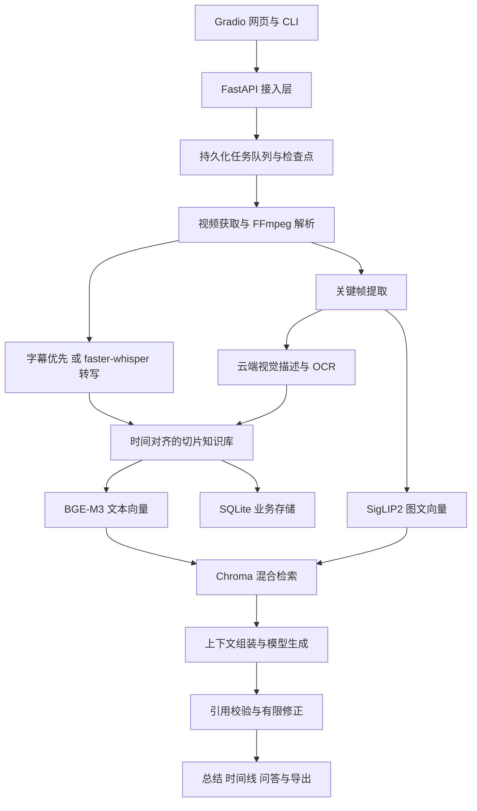

# VideoLens 知影项目构建与验证计划

版本：1.0；确认日期：2026-10-14；状态：用户已批准，进入实施。

## 一、项目目标与实施依据

构建适合个人电脑运行的视频智能分析助手，将本地视频或在线视频链接转化为可检索、可追溯、可继续追问的知识。首版交付完整核心流程、Gradio 网页和命令行工具，使用 Miniconda 的 `VideoLens` 环境，使用本地 Git 管理版本。

需求来源：[知影需求文档](./知影--视频智能分析助手.docx)。用户已明确同意本计划并要求实施。原计划中的“等待审阅、尚未实施”状态由本次批准替代。

### 已确认范围

- 视频获取、字幕解析、语音转写、关键帧提取、视觉描述与 OCR、文本及图像向量检索。
- 总结、时间线、关键词、标签、多轮问答和证据引用。
- 任务进度、暂停、恢复、取消、崩溃恢复，以及数据删除、TTL 清理和索引重建。
- 云端模型主要负责文本生成和视觉理解；本地保留 faster-whisper、BGE-M3、SigLIP2，并提供 llama.cpp 一键部署与本地文本生成。
- 首版实现 Web、CLI 和标准化后端 API；Obsidian、MCP、QQ-Bot、浏览器扩展进入后续路线图。

### 参考项目

| 项目 | 检查基线 | 参考内容 | 实施方式 |
|---|---|---|---|
| [VideoHub](https://github.com/dirge2024/VideoHub) | `e1336f2936c6a4a4a20b4325170da436d24f8d81` | 异步任务、时序上下文、检查点、长视频检索、证据校验、执行预算 | 改造成 Python 单机架构，采用 SQLite、Chroma、本地文件 |
| [WebSideChat](https://github.com/Zhang1933/WebSideChat/blob/main/README_ZH.md) | `7a3ff656c8913deef14c7ce321795152b1497af8` | 模型设置、多轮会话、提示词、流式输出、会话隔离 | 参考设计，独立实现，不复制代码和素材 |

VideoHub 采用 MIT 许可证；实际改编代码须保留版权、许可及改动记录。WebSideChat 采用 CC BY-NC 4.0，本项目仅参考交互设计。第三方许可保留原文，另附中文说明。

初始环境：项目只有需求文档、空 src 与空 README，尚未初始化 Git；`D:\Environment\VideoLens` 使用 Python 3.13.16；Windows 11、约 32GB 内存、RTX 5060 Laptop GPU 约 8GB 显存。

## 二、架构与核心实现

### 分层架构

Python 为主要语言，FastAPI 提供 API 并挂载 Gradio，CLI 使用相同 API。核心代码位于 `src/videolens`，划分为接入层、任务编排、媒体处理、模型适配、检索问答、存储与配置管理。

SQLite 保存视频、任务、切片、转录、帧元数据、会话、检查点，是业务恢复依据；Chroma 保存可重建向量索引，两者职责不可混淆。

### 视频处理

- 支持 MP4/MKV/AVI/MOV、yt-dlp 可解析的 HTTP/HTTPS 链接；默认最长 2 小时、最大 4,000,000,000 字节、URL 最长 2048 字符。
- 上传、下载、哈希采用流式处理。下载最多重试 3 次，指数退避，支持工具自身断点续传。
- FFprobe 获取时长、流、分辨率；FFmpeg 提取 16kHz 单声道音频。外部程序使用参数列表，支持中文、空格、特殊字符路径。
- 外部、内嵌、下载字幕优先，支持 SRT/VTT/ASS；无字幕调用 faster-whisper。默认中文字幕优先，语言可配置。
- 切片目标 20 秒，优先句末或间隔边界，默认 10—30 秒，参数支持 5—60 秒。无语音视频生成视觉切片。
- 每片默认最多 3 帧，场景变化优先、均匀采样补足，去重后可少于 3 帧，数量可设 1—5。
- 记录实际帧时间与尺寸。低于 720p 的源保持原分辨率；优先压缩至 200KB，不能兼顾可读性时记录偏差。
- 视觉输出描述、OCR 并关联帧 ID；视觉失败保留语音/字幕，并标识降级。

### 模型与检索问答

| 用途 | 默认实现 | 位置 |
|---|---|---|
| ASR | Systran/faster-whisper-small | 本地 GPU 或 CPU |
| 文本向量 | BAAI/bge-m3 | 本地 |
| 图文向量 | google/siglip2-base-patch16-224 | 本地 |
| 总结、问答 | 用户配置的 OpenAI 兼容接口 | 云端优先 |
| 描述、OCR | 用户配置的 OpenAI 兼容视觉接口 | 云端 |
| 本地生成 | Qwen/Qwen3-4B-GGUF 的 Qwen3-4B-Q4_K_M.gguf | llama.cpp |

统一适配模型；文本和视觉可分别配置供应商、地址、模型。默认一个重型分析任务，模型按阶段加载，进入本地生成前释放向量模型。

- BGE-M3 检索转录和描述，SigLIP2 检索图像，jieba 关键词辅助字面检索；支持文字检索图像、图片检索关键帧。
- 每路候选默认 20 条，映射到切片并去重；加权 RRF 默认文本 0.5、图文 0.3、关键词 0.2，常数 60，最终 8 片，均可配置。
- 不相加不同模型原始分数；缺失一路时重新归一化权重，向量失败降级关键词检索。
- 长视频默认每 5 分钟建立章节摘要，使用章节—切片—证据分层上下文。
- 按模型上下文容量计算预算、预留输出；会话使用历史摘要、近期消息、本轮证据，按视频与会话隔离。
- 结构化结果每条实质结论须有转录或帧引用；校验 ID、区间、摘录。失败最多一次补充检索修正，再失败返回有效摘录或证据不足。
- 引用合法性不等于语义正确，问答效果单独人工验证。
- 云端文本失败尝试 llama.cpp；两者失败输出明确标识的关键词、时间线和摘录报告。

### 任务与生命周期

提交立即返回任务 ID；状态包括 queued、running、pause_requested、paused、cancel_requested、cancelled、succeeded、partial、failed。

- 阶段检查点持久化，复用配置兼容的产物；暂停在安全边界生效，取消中断请求或本项目子进程并释放资源。
- 重启恢复排队/中断任务，主动暂停/取消不恢复；指纹、配置与模型版本决定复用，幂等写入避免重复数据。
- Chroma 索引写入可重试，新版本完整后切换，不假设跨库事务。
- 完成后清理临时音频；失败中间文件默认保留 24 小时。
- 受管理播放副本默认保留 7 天，可配置；到期保留证据与帧，播放需重新导入。用户原文件不自动删除。
- 结果与索引默认长期保存，可配置 TTL、容量及级联删除。

### 接口

统一 `/api/v1`：视频导入/上传/列表/详情，任务创建/状态/控制/SSE，文本与图片检索，会话与流式问答，JSON/Markdown 导出，设置与模型检查，重建与清理。SSE 包含事件编号并支持重连。密钥只写不读。

统一错误结构、OpenAPI、JSON Schema；内部整数毫秒，对外同时提供毫秒和 HH:MM:SS.mmm，界面和 Markdown 使用格式化时间；结果不暴露内部绝对路径。

## 三、网页、脚本与文档

### 网页与 CLI

- 视频库、分析工作区、报告/对话、模型/系统设置；拖拽或 URL 导入、一键分析、阶段进度、暂停恢复取消。
- 总结、章节、帧、转录、引用；时间戳定位；持续追问、文本/图片检索、JSON/Markdown 导出、删除、重建。
- 设置支持供应商、模型、连接测试、提示词及默认恢复、路径、切片、帧数、并发、清理；浅/深主题。
- Markdown 不执行不可信 HTML。
- CLI：analyze、ask、search、export、tasks、models、doctor、serve；中文帮助和示例。
- 云端密钥后端 Windows 凭据管理器存储，配置仅引用；不进入浏览器持久化、Git、日志和导出。
- 首次启用云端说明发送转录、问题、关键帧，不上传原始视频。默认 127.0.0.1:8000，API 令牌及网页认证。
- 云端调用、媒体下载、模型下载分别控制；关闭云端分析时不外发用户内容。

### 一键脚本

根目录提供一键配置环境.cmd、一键启动.cmd、一键测试.cmd，由 PowerShell/Python 实现。

- 查找 Miniconda，复用/创建 VideoLens，不安装到 base。
- Python 3.13 优先；实测不兼容则改为 3.12；修改前导出环境，不删除整个环境。
- 安装并验证 FFmpeg/FFprobe、依赖、开发工具；显示模型来源、大小、缓存、进度，固定版本并校验。
- 下载校验 llama.cpp，CPU 基线先验证，CUDA 单独验证；支持指定下载地址和本地文件，不依赖 GitHub API 才能安装。
- 分别测试 PyTorch、CTranslate2、CUDA、llama.cpp，不能仅检测显卡存在；通过后锁定依赖。
- 使用 conda run -n VideoLens；重复配置复用已有内容。
- 启动检查环境、配置、端口、数据库，启动服务，健康检查后打开浏览器，模型延迟加载；仅清理本项目进程。

### Git、编码、注释

初始化本地 main 分支，阶段提交，不创建或推送远程仓库。忽略环境、模型、媒体、数据库、缓存、日志、密钥、私人配置。自编写文本 UTF-8，原二进制不改。

中文注释和类型注解说明输入、输出、原因、失败、资源释放；为初学者解释时间、切片、适配器、检索、检查点、SSE、Git，避免机械复述代码。

交付简体中文 README、使用手册、开发手册、架构与代码导读、API 文档、测试报告、故障排查、第三方说明。开发文档完整追踪一次分析和一次追问的代码入口、数据变化和存储。

### 阶段

1. 保存计划、需求追踪、初始化仓库、骨架。
2. 环境脚本、配置、数据、任务与检查点。
3. 媒体、字幕、真实 ASR、关键帧。
4. 视觉接口、向量模型、混合检索、索引。
5. llama.cpp、总结问答、证据校验、降级。
6. Gradio、CLI、启动与完整用户流程。
7. 自动化/真实模型测试、修复、文档、README。

## 四、验证与验收

口径：功能必须通过，质量性能如实测量；模拟、本地真实、云端真实分开记录。

| 层级 | 主要场景 | 要求 |
|---|---|---|
| 单元 | 字幕、时间、切片、去重、排序、预算、引用、状态 | 无 GPU/网络也运行 |
| 媒体集成 | 中文路径、外部/内嵌/无字幕、无音轨、损坏、低清 | 真实 FFmpeg |
| 存储任务 | 重复提交、索引失败、取消暂停重启、删除 TTL 重建 | 幂等、恢复、不误删 |
| API/SSE | 鉴权、限流、错误、跨块、重连、终态 | 不将断流当成功 |
| 网页/CLI | 配置导入分析追问定位导出清理 | 浏览器及真实命令 |
| 本地模型 | ASR、BGE、SigLIP、llama.cpp，CPU/GPU | 真实推理，不以 Mock 替代 |
| 云端 | 文本视觉流式、超时限流无效密钥 | 配置真实服务后测试，否则待验收 |
| 隐私编码 | 密钥、日志、导出、离线外发、中文 | 不泄密、UTF-8 |

样例包含自动生成字幕、文字画面、静态板书、场景变化视频及标准时间线；许可明确的中英文短音频及参考文本；人工问题和参考证据；短/超长/超大/空字幕/重复帧/坏 URL/磁盘不足/模型不可用。

记录 CER、WER、对齐误差、帧尺寸/大小/时间、检索命中、引用合法率和人工语义检查；记录各阶段耗时、内存显存、模型硬件版本；区分首 SSE、首真实 Token、完整回答耗时。记录冷/暖启动与一小时专项，不用短样本推算达标。

最终必须完成：一键配置→启动→导入→分析→证据→追问→导出→重启读取。报告列出通过、失败、未执行、待配置及复现命令；修复关键功能失败，未达标指标明确写差距。

## 五、默认与需求调整

- 保留 Python/Gradio/SQLite/Chroma 单机方案；复用既有环境，版本以实际兼容性为准。
- 默认分析并发 1，分阶段加载；CPU 必须可用，GPU 实测后启用。
- 云端文本、视觉独立配置；未配置可用本地/基础报告，但不能宣称完成云端验收。
- 包含 llama.cpp 部署；不包含本地视觉模型一键部署，视觉云端失败明确降级。
- 可降级阶段失败允许部分成功；无法获取或解码视频为致命失败。
- 720p/200KB 记录真实结果，不能伪造；质量性能记录素材与服务边界。
- 不创建 GitHub 仓库，不部署公网；提供 Linux 适配说明，Windows 测试不能作为 Linux 证明。
