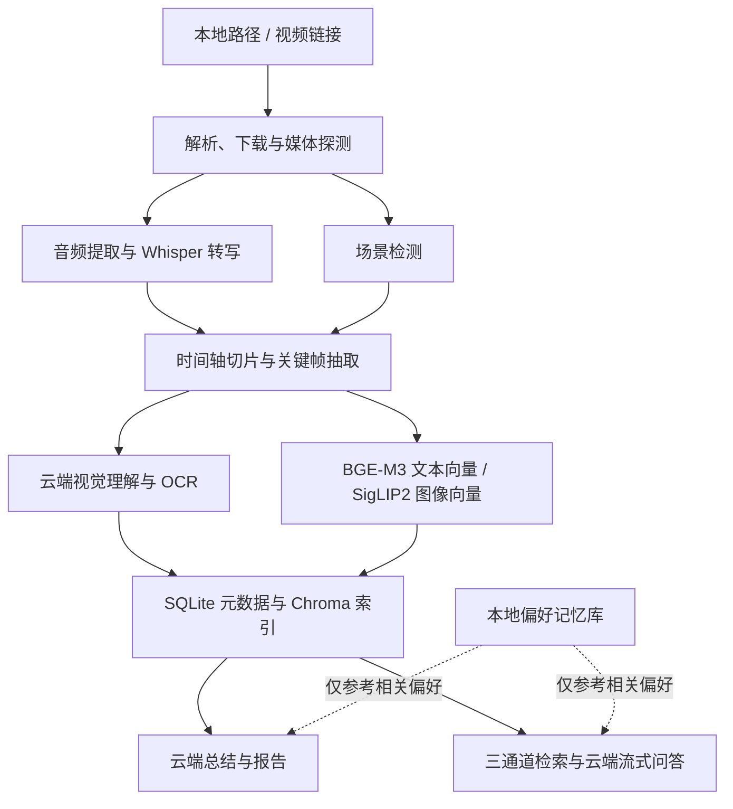

# VideoLens · 知影

**把视频变成可阅读、可检索、可追问的知识。**

VideoLens 是面向本机使用的视频分析与问答工具。输入本地视频路径或公开视频链接，即可获得内容概览、关键结论与时间脉络，并围绕视频展开带证据引用的多轮对话。

独立 HTML / CSS / JavaScript 前端由 FastAPI 托管。语音转写和向量编码使用三个必需本地模型；视觉理解、画面文字识别、总结和问答使用用户配置的云端 API。

## 工作流程



切片主要是数据库中的文字、时间范围与帧关联，并非为每一片生成独立视频文件。详见[工作流程与数据存放](工作流程与数据存放.md)。

## 快速入手

完整步骤见[快速上手](快速上手.md)。已安装并初始化 Conda 的 Git Bash 用户，在安装 FFmpeg、把含 `ffmpeg.exe` 和 `ffprobe.exe` 的 `bin` 目录加入系统 PATH 后执行：

```bash
cd /d/Project/vl/VideoLens
conda create -n VideoLens python=3.13 pip -y
conda activate VideoLens
python -m pip install -r requirements.txt
python scripts/download_models.py --verify
bash scripts/start_web.sh --port 8000
```

打开[视频分析工作台](http://127.0.0.1:8000/ui)。首次启动后在“设置”中填写文本、视觉两个云端通道的地址、模型名和 API Key，保存并通过右上角菜单重启。云端未配置时仍可进入设置，分析与问答会明确要求先完成配置；三个本地模型始终必须加载成功。

日常运行只需激活环境并执行启动脚本，终端输入 `stop` 关闭，输入 `restart` 重启。

## 特色功能

| 功能 | 说明 | 文档 |
| --- | --- | --- |
| 三个本地模型独立选择 CPU / GPU | Whisper small、BGE-M3、SigLIP2 可分别选择设备，保存后安全切换 | [设备切换](本地模型与CPU-GPU切换.md) |
| 云端模型自行接入 | OpenAI 兼容协议，文本和视觉通道独立配置，地址与模型名不预填 | [云端接入](云端模型接入.md) |
| 两种报告视图 | 用户模式展示概览与结论，详细模式展示完整报告；即时切换，保留完整数据 | [网页设置](本地模型与CPU-GPU切换.md) |
| Markdown 与证据问答 | 支持流式 Markdown、引用时间定位与独立多轮会话 | [工作流程](工作流程与数据存放.md) |
| 可管理的偏好记忆 | 历史归纳、手动增改删，文字与 BGE 向量映射保存在本地，无关偏好静默忽略 | [记忆库](记忆库.md) |
| 前台控制台与网页菜单 | 黄色 `<< ` 输入标识，支持状态、清屏、正常关闭和重启 | [控制台命令](控制台命令.md) |
| 按启动分开的日志 | `YYYY-MM-DD-CNT.log`，统一时间/级别/线程格式，关键状态局部着色 | [日志说明](日志文件与格式.md) |
| 并发与缓存复用 | 场景检测与转写重叠，云端视觉与本地编码重叠，同视频串行与缓存复用 | [并发优化](模型并发与性能优化.md) |
| 代码、环境、数据分离 | Conda 管理 Python 环境，模型、密钥、缓存和业务数据放在源码外 | [数据目录](工作流程与数据存放.md) |

视频库中云端视频标题旁的“本地缓存”可打开下载文件所在目录。

## 10 分钟视频性能实测

2026-10-28，在 Windows 11、Intel Core Ultra 7 255H、NVIDIA RTX 5060 Laptop GPU 上，三个本地模型均使用 GPU，两个云端通道使用当时已配置的 `qwen3.5-flash`，对 **600.033 秒**真实视频片段执行一次完整流程：

| 项目 | 实测耗时 |
| --- | ---: |
| 首次完整分析 | **73.19 秒**，客户端观察 73.46 秒 |
| 同视频结果复用 | 客户端观察 **1.03 秒** |
| 一次带引用问答 | 客户端观察 **5.37 秒** |

包含 Whisper 转写、场景检测、切片、68 张关键帧、云端视觉/OCR、95 条向量与总结。测试从本地文件开始，**不含网络下载、权重下载与启动预热**。这是单样本、单次观测，不能视为固定性能承诺；并发阶段耗时不可直接相加。方法与完整阶段数据见[10 分钟视频性能测试](10分钟视频性能测试.md)。

## 项目结构

```text
VideoLens/
├─ backend/           网页、模型接入、媒体、切片、流水线、检索、存储与记忆
├─ frontend/          工作台、对话页及公共组件
├─ configs/           无密钥默认配置、模型清单与提示词
├─ docs/              README 与分主题文档
├─ scripts/           模型下载、启动、预检、重建索引与维护
├─ tests/             自动化测试源码
├─ LICENSE            项目许可证
├─ requirements.txt   当前 Conda 环境的依赖清单
└─ start.bat          Windows 网页启动入口

VideoLens-runtime/    默认与源码同级，保存模型、数据、密钥、缓存和日志
```

验证方法见[测试与维护](测试与维护.md)。Python 来自已激活的 Conda 环境；FFmpeg / FFprobe 由用户安装并通过系统 PATH 定位。项目仅提供本机网页工作流。

## 开源协议

项目代码采用 [MIT 许可证](../LICENSE)。内置 marked、DOMPurify 保留各自许可证；模型、其他依赖与云端服务分别适用原有授权条件。详见[开源协议与第三方依赖](开源协议与第三方依赖.md)。权重、密钥、视频、数据库、日志与运行环境不随源码发布。

## 参考与致谢

- [dirge2024/VideoHub](https://github.com/dirge2024/VideoHub)：长视频理解与 Video Agent 产品设计参考，MIT 许可证。
- [Zhang1933/WebSideChat](https://github.com/Zhang1933/WebSideChat)：围绕内容进行侧边对话的交互设计参考，CC BY-NC 4.0 许可证。

参考仓库内容分别受其原许可证约束，本项目的 MIT 许可不改变参考项目的许可条件。
