# VideoLens · 知影

**把视频变成可阅读、可检索、可追问的知识。**

VideoLens 是本机视频分析与问答工具。在对话工作台选择本地视频，或粘贴包含视频链接的分享文本，即可获得内容概览、关键结论与时间脉络。消息附带的问题会在分析完成后自动回答，后续可继续进行带证据引用的多轮对话。

独立 HTML / CSS / JavaScript 前端由 FastAPI 托管。语音转写、文本/图像向量编码使用三个必需本地模型；视觉理解、OCR、总结和问答使用用户配置的云端 API。界面采用 Fluent UI，支持浅色、深色和跟随系统。

可选的本地stdio MCP接入支持AstrBot / QQ：回复Bilibili原视频发送“视频分析”，回复同一视频继续追问，复用现有模型与后端。

**QQ机器人接入：[AstrBot 详细部署与使用教程](功能介绍/AstrBot接入教程.md)**，包含Windows＋Git Bash安装、NapCat连接、MCP配置、插件安装、图片回复和故障排查。

## 工作流程

```mermaid
flowchart TD
    U[本地视频 / 分享链接与问题] --> A[云端任务助手理解来源与意图]
    A --> B[本地软链接 / 1080p下载与探测]
    B --> C[匹配字幕 / 转写缓存 / Whisper转写]
    B --> D[复用解码器固定取帧]
    D --> E[边产帧边云端画面概述与OCR]
    C --> F[语音、画面、OCR证据与时间绑定]
    E --> F
    F --> G[完整句、表格行、事实单元按预算选择]
    G --> H[单次云端报告]
    F --> I[BGE-M3 / SigLIP2索引]
    H --> J[报告和索引均成功后发布]
    I --> J
    J --> K[会话标题、自动提问及后续问答]
    M[本地可管理偏好记忆] -.仅使用相关偏好.-> H
    M -.仅使用相关偏好.-> K
```



新分析默认使用fast-v4，不运行镜头检测，不使用局部加密、高清裁图或递归章节总结。旧报告继续复用，强制重跑成功后才替换活动版本。切片通常是文字、时间和帧关联，不为每个切片保存一段MP4。

## 快速入手

完整步骤见[快速上手](快速上手.md)。已初始化Conda的Git Bash用户，先安装FFmpeg并将含 `ffmpeg.exe`、`ffprobe.exe` 的bin目录加入系统PATH，然后执行：

```bash
cd /d/Project/vl/VideoLens
conda create -n VideoLens python=3.13 pip -y
conda activate VideoLens
python -m pip install -r requirements.txt
python scripts/download_models.py --verify
bash scripts/start_web.sh --port 8000
```

打开[视频分析工作台](http://127.0.0.1:8000/ui)，在设置中填写文本、视觉两个云端通道的地址、模型名和API Key，按提示重启。三个本地模型必须加载成功；Python来自激活的Conda环境，FFmpeg/FFprobe使用系统PATH。

## 特色功能与使用说明

| 功能 | 说明 | 文档 |
| --- | --- | --- |
| 智能对话工作台 | 本地原文件软链接、分享链接提取、分析后自动追问、时间跳转和历史恢复 | [工作台](功能介绍/智能对话工作台.md) |
| 报告与Markdown复制 | 用户/详细模式即时切换，一键复制报告或回答原始Markdown，报告可导出 | [工作台](功能介绍/智能对话工作台.md) |
| 本地模型独立CPU/GPU切换 | Whisper small、BGE-M3、SigLIP2分别设置设备，严格加载，失败不降级 | [模型与设备](功能介绍/本地模型与CPU-GPU切换.md) |
| 云端模型接入 | 文本、视觉独立配置，OpenAI兼容协议，不预填私人地址或密钥 | [云端接入](功能介绍/云端模型接入.md) |
| 可管理记忆空间 | 单一折叠空间，新建、修改、多选删除，相关偏好用于总结和问答 | [记忆库](功能介绍/记忆库.md) |
| 明暗主题与文字导航 | Fluent UI、玻璃材质、隐藏式历史抽屉、知影头像 | [界面主题](功能介绍/界面主题与导航.md) |
| 前台服务控制 | Git Bash控制台指令和网页菜单正常重启/关闭，控制台支持clear | [控制台](功能介绍/控制台命令.md) |
| 日志与阶段计时 | 按启动独立日志、关键状态局部着色、各阶段及总耗时汇总 | [日志格式](功能介绍/日志文件与格式.md) |
| AstrBot / QQ / MCP | 原视频引用触发、群友独立上下文、异步分析与自动问答，复用本机模型 | [完整接入教程](功能介绍/AstrBot接入教程.md) |
| 视频与会话联动管理 | 视频库采用对话标题，显示原链接/本地路径，双向联动删除保护原文件 | [数据与删除规则](技术分析/工作流程与数据存放.md) |

## 技术分析

- [工作流程与数据存放](技术分析/工作流程与数据存放.md)：分析、问答、版本隔离、本地软链接和数据目录。
- [并行分析与完整事实打包](技术分析/并行分析与完整事实打包.md)：无镜头检测、解码/网络复用、转写缓存、完整证据预算与关键词评分。
- [轻量关键词辅助](技术分析/轻量关键词辅助.md)：有界统计模型、完整型号与重复OCR保护、速度约束及实测边界。
- [模型并发与性能优化](技术分析/模型并发与性能优化.md)：本地锁、GPU批次、云端并发与失败恢复。
- [分析策略与资源配置](技术分析/完整性分析与资源配置.md)：当前默认值、输入输出预算和兼容边界。
- [测试与维护](技术分析/测试与维护.md)：Conda自检、前后端回归、开发维护及发布约定。
- [本地MCP接入](技术分析/本地MCP接入.md)：可选桥接、工具协议、QQ引用门控与独立运行环境。

## 视频性能实测

2026-11-01，对指定 **11分26秒、1920×1080** 视频进行同机真实测量：

| 测试 | 网页全流程耗时 |
| --- | ---: |
| 同日旧版基线 | 135.71秒 |
| fast-v4完整重跑 | **62.45秒** |
| 允许复用转写、其余重跑 | 58.45秒 |

完整重跑包含下载、重新Whisper转写、70帧识别、索引、报告和标题，不含服务启动或模型加载。三个本地模型均为CUDA。最终轮比同日基线减少约54.0%，此前新版完整重跑为70.64秒；云端延迟与重试会引起波动，不能据此承诺所有视频固定加速。

报告在241个完整单元中选择73个，关联36/36个切片；这不代表全部事实召回。尚未完成全量人工事实校验。方法、阶段数据、tokens及局限见[并行分析验收](更新日志/2026-11-01并行分析验收.md)，更早测量保存在[历史10分钟测试](更新日志/10分钟视频性能测试.md)。

## 更新日志与历史验收

[更新日志目录](更新日志/README.md)集中保存版本变化、修复经过、真实验收与退出默认路径的旧策略；[版本记录](更新日志/版本记录.md)按版本说明变化。`main` 持续更新，`2026-11-1-lts` 保留首次发布快照，不随main移动。

## 项目结构

```text
VideoLens/
├─ backend/             模型接入、媒体、切片、分析、检索、存储与网页内部接口
├─ frontend/            对话工作台、主题与公共组件
├─ configs/             无密钥默认配置、模型清单与提示词
├─ integrations/        AstrBot插件、stdio MCP桥接、安装器与无凭据模板
├─ docs/
│  ├─ README.md         项目介绍与文档导航
│  ├─ 快速上手.md       FFmpeg、Conda与启动
│  ├─ 功能介绍/        当前使用方式
│  ├─ 技术分析/        当前架构、策略与维护
│  └─ 更新日志/        版本变化、验收记录与历史策略
├─ scripts/             模型下载、启动、自检和维护
├─ tests/               自动化测试源码
├─ requirements.txt     激活Conda环境后安装的依赖
├─ start.bat            Windows网页启动入口
└─ LICENSE

VideoLens-runtime/      源码外的模型、数据、密钥、缓存、日志与测试产物
```

## 开源协议与参考

项目采用 [MIT许可证](../LICENSE)，第三方前端库、模型、依赖与云端服务遵守各自许可，详见[开源协议与第三方依赖](开源协议与第三方依赖.md)。权重、密钥、业务数据和环境不随源码发布。

- [dirge2024/VideoHub](https://github.com/dirge2024/VideoHub)：长视频理解与Video Agent产品设计参考，MIT许可证。
- [Zhang1933/WebSideChat](https://github.com/Zhang1933/WebSideChat)：围绕内容对话的交互设计参考，CC BY-NC 4.0许可证。

本项目MIT许可不改变参考仓库的原有许可条件。
