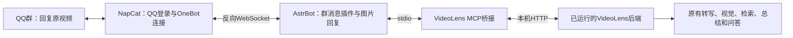

# AstrBot 接入详细教程：在 QQ 群分析和追问视频

本教程面向 **Windows＋Git Bash＋Conda**。先让 VideoLens 网页正常分析视频，再安装 AstrBot、NapCat 和本仓库的插件，即可在 QQ 群回复 Bilibili 视频消息触发分析，并继续追问。

已安装的用户可跳到[日常启动与关闭](#日常启动与关闭)和[更新插件](#更新插件)。功能概览和原有本机部署信息见[AstrBot 与 QQ 视频分析](AstrBot与QQ视频分析.md)。

## 接入后的用法

1. 群友分享一条 Bilibili 视频链接、`b23.tv` 短链接或包含真实视频地址的分享卡片。
2. **回复这条原视频消息**，发送 `视频分析`。
3. 机器人先发送简短文字提示，再以图片发送报告，长结果自动分页。
4. 继续**回复同一条原视频消息**提问，例如 `两款CPU的游戏表现有什么区别？`，机器人以图片回答。
5. 首次也可以发送 `视频分析 为什么作者推荐这款CPU？`：后端先完成分析，再自动回答附带问题。

普通群消息、没有引用的“视频分析”，以及回复机器人报告图片的普通问题，不会触发视频任务。**追问要回复原视频，不是回复报告。**

## 一、三个程序与 MCP 的关系



| 组件 | 职责 | 环境 | 示例入口 |
| --- | --- | --- | --- |
| VideoLens | 下载、转写、视觉、索引、报告与问答 | Conda，Python 3.13 | `http://127.0.0.1:8000/ui` |
| AstrBot | 接收消息、执行插件、管理 MCP、发送图片 | 独立 Conda，Python 3.12 | `http://127.0.0.1:6185` |
| NapCat | 登录 QQ，提供 OneBot v11 连接 | Windows Node 包自带 Node | `http://127.0.0.1:6099`，以日志为准 |
| MCP 桥接 | 复用 VideoLens 内部工作流 | AstrBot 环境的 Python | stdio，无独立端口 |

**两个 Conda 环境即可，NapCat 不需要 Conda。** MCP 由 AstrBot 自动启动，不需要单独开终端运行。三个本地模型仍只由 VideoLens 加载和管理，不会因机器人重复部署。

本接入不需要为 AstrBot 另配大模型。分析、OCR、总结、追问继续使用 VideoLens 的文本和视觉通道；插件按明确的引用与关键词调用工具，不依靠另一个大模型猜测是否调用。

本插件目前支持 **OneBot v11 群消息**，联调使用 NapCat＋AstrBot 的 `aiocqhttp` 适配器。安装到 QQ 官方机器人平台等其他适配器后，不能假定直接兼容。

## 二、版本与示例目录

已联调基线为 **AstrBot v4.29.4、NapCat v4.18.42、知影插件 v1.1.1**。插件声明支持 `AstrBot >=4.29.4,<5`；其他版本仍应完成后面的验收，声明范围不代表每个版本都已测试。

```text
D:/Project/vl/VideoLens/            本项目源码
D:/Project/vl/VideoLens-runtime/    模型、视频、缓存、桥接状态
D:/Project/AstrBot/                AstrBot 源码及其 data 目录
D:/Project/NapCatQQ/               NapCat Windows Node 发行包
```

路径可以修改，但 MCP 配置必须使用修改后的真实路径。Conda 环境名以 `VideoLens`、`AstrBot` 为例；如果你按前缀安装环境，使用 `conda activate D:/Environment/AstrBot` 等实际路径。

官方来源：

- [AstrBot 源码](https://github.com/AstrBotDevs/AstrBot)、[v4.29.4 发布页](https://github.com/AstrBotDevs/AstrBot/releases/tag/v4.29.4)、[官方文档](https://docs.astrbot.app/)。
- [NapCat 源码](https://github.com/NapNeko/NapCatQQ)、[v4.18.42 发布页](https://github.com/NapNeko/NapCatQQ/releases/tag/v4.18.42)、[官方文档](https://napneko.github.io/)。

## 三、先启动 VideoLens

尚未安装时，先完成[快速上手](../快速上手.md)：安装 FFmpeg/FFprobe 并加入系统 PATH，创建 Python 3.13 Conda 环境，安装 `requirements.txt`，下载并验证三个必需模型。

在 Git Bash 启动：

```bash
cd /d/Project/vl/VideoLens
conda activate VideoLens
bash scripts/start_web.sh --host 127.0.0.1 --port 8000
```

打开 [VideoLens 工作台](http://127.0.0.1:8000/ui)，在设置中填写文本、视觉两个云端通道的地址、模型名和 API Key。先在网页完成一次正常分析和追问，再接 QQ，以便区分模型问题与连接问题。

在另一个终端检查本机服务：

```bash
curl --noproxy '*' http://127.0.0.1:8000/internal/health
```

三个本地模型仍须严格加载成功，机器人不会跳过下载、改用哈希向量或其他模型。当前桥接要求 AstrBot 与 VideoLens 在同一台电脑，地址仅支持回环 HTTP 根地址。

## 四、安装 AstrBot 独立环境

已安装的用户使用现有环境，跳过创建和克隆。不要把 AstrBot 依赖装进 VideoLens 模型环境。

```bash
conda create -n AstrBot python=3.12 pip -y
conda activate AstrBot

git clone --branch v4.29.4 --depth 1 \
  https://github.com/AstrBotDevs/AstrBot.git /d/Project/AstrBot

cd /d/Project/AstrBot
python -m pip install -r requirements.txt

# MCP SDK 与 AstrBot 安装在同一环境
python -m pip install -r D:/Project/vl/VideoLens/integrations/requirements-mcp.txt
python -m pip check

# 记下输出，MCP 的 command 要使用这个 python.exe
python -c "import sys; print(sys.executable)"
```

启动：

```bash
cd /d/Project/AstrBot
conda activate AstrBot
python main.py
```

打开 [AstrBot 面板](http://127.0.0.1:6185)，按启动日志或首次登录引导完成登录并设置自己的管理密码。端口改过时，以实际日志为准。管理密码、QQ 密码不要填进本项目源码。

源码安装首次启动会尝试下载面板文件。如果显示“WebUI 文件缺失”，到对应版本发布页下载 `AstrBot-v4.29.4-dashboard.zip`，将其中的 `dist` 目录放到 `D:/Project/AstrBot/data/`，确认 `data/dist/index.html` 存在，再正常重启。不要混用不同版本面板包。

## 五、安装和登录 NapCat

1. 到 [NapCat v4.18.42 发布页](https://github.com/NapNeko/NapCatQQ/releases/tag/v4.18.42)下载 **`NapCat.Shell.Windows.Node.zip`**。
2. 解压到 `D:/Project/NapCatQQ/`，确认根目录有 `node.exe`、`index.js`、`napcat.bat`；若多套一层文件夹，进入实际包含这些文件的目录。
3. 在另一个 Git Bash 窗口前台启动：

```bash
cd /d/Project/NapCatQQ
./node.exe ./index.js
```

使用发行包自带 Node，不需要激活 Conda 或安装系统 Node。`napcat.bat` 是同类启动入口；Git Bash 直接用上述命令即可。

按控制台提示打开 NapCat 面板并登录 QQ。扫码、验证码和设备验证由你在本机完成。将机器人 QQ 加入准备测试的群；登录状态由 NapCat 自己维护，不写入 VideoLens 源码。

## 六、连接 NapCat 和 AstrBot

这是一条**反向 WebSocket**连接：AstrBot 监听，NapCat 主动连接。它与 MCP 的 stdio 不是同一条连接。

### AstrBot 侧

在面板的消息平台/机器人管理中新增 **OneBot v11 / aiocqhttp**：

| 字段 | 示例值 |
| --- | --- |
| 平台 ID | `videolens-qq`，自定义且不重复 |
| 启用 | 开启 |
| 反向 WebSocket 地址 `ws_reverse_host` | `127.0.0.1` |
| 监听端口 `ws_reverse_port` | `6199` |
| 连接令牌 `ws_reverse_token` | 自己设置的连接令牌，NapCat 填同一个 |

保存并按面板提示生效。已有全局白名单或平台过滤规则时，也要允许测试群。

### NapCat 侧

在网络配置中新增或启用 **WebSocket 客户端**：

| 字段 | 示例值 |
| --- | --- |
| 连接地址 | `ws://127.0.0.1:6199/ws` |
| Token/Access Token | 与 AstrBot 的 `ws_reverse_token` 一致 |
| 消息上报格式 | `array` / 消息段数组 |
| 启用 | 开启 |
| 上报自身消息 `reportSelfMessage` | 日常关闭 |

保存后确认两边日志显示连接建立。接收群友视频和发送报告不需要额外启用 OneBot HTTP，插件通过这条连接调用 `get_msg` 和发送消息。

不要把 `6185`、`6099` 或 `8000` 填成 OneBot 端口，它们分别对应 AstrBot 面板、NapCat 面板和 VideoLens 服务。

## 七、注册 VideoLens MCP

模板见 [integrations/mcp-server.example.json](../../integrations/mcp-server.example.json)。下方 Python 路径只是已有本机部署的示例，必须替换为第四步 `sys.executable` 的实际输出。

```json
{
  "mcpServers": {
    "videolens": {
      "command": "D:/Environment/AstrBot/python.exe",
      "args": ["D:/Project/vl/VideoLens/integrations/videolens_mcp/server.py"],
      "env": {
        "PYTHONUTF8": "1",
        "PYTHONPYCACHEPREFIX": "D:/Project/vl/VideoLens-runtime/cache/pycache",
        "VIDEOLENS_URL": "http://127.0.0.1:8000",
        "VIDEOLENS_MCP_STATE": "D:/Project/vl/VideoLens-runtime/data/mcp/qqbot.sqlite3"
      },
      "active": true
    }
  }
}
```

在 AstrBot 面板的 MCP 管理中导入或添加配置。若编辑框只接受单个服务，名称填 `videolens`，内容填写内层对象，不要重复嵌套 `mcpServers`。

也可以在 AstrBot 停止后合并到 `D:/Project/AstrBot/data/mcp_server.json`，然后启动。已有其他 MCP 时保留它们，只新增 `videolens` 项，不覆盖整个文件。

- `command` 必须是 AstrBot 环境的 **python.exe 绝对路径**，不是 `conda activate AstrBot`，不依赖系统 PATH。
- JSON 路径使用 `/`，避免反斜杠转义；`server.py` 必须真实存在。
- `VIDEOLENS_URL` 末尾不加 `/ui`、`/internal` 或 `/mcp`。
- MCP 名称与插件设置一致，统一为 `videolens`。
- stdio MCP 不需要额外端口；手动运行脚本后等待输入，不能代替在面板注册。

启用并连接后，应能列出四个工具：

| 工具 | 用途 |
| --- | --- |
| `videolens_status` | 查看 VideoLens 就绪状态与实际设备 |
| `videolens_analyze` | 提交 Bilibili 分析，立即返回任务 |
| `videolens_ask` | 在已绑定视频会话中追问 |
| `videolens_result` | 查询进度、报告与回答 |

先测试 `videolens_status`；后端未就绪时先修复 VideoLens，不要仅加大插件超时。MCP 不提供任意本地文件分析、删除或命令执行工具。

## 八、安装知影插件

**只注册 MCP，不会自动获得“回复视频分析”的行为。** 知影插件负责引用解析、关键词门控和图片回复。

在独立 Git Bash 窗口执行：

```bash
cd /d/Project/vl/VideoLens
conda activate AstrBot

# 备份旧文件和设置，再同步到 AstrBot 真实插件目录
python integrations/install_astrbot_plugin.py --astrbot-root D:/Project/AstrBot

# 只读核对
python integrations/install_astrbot_plugin.py --astrbot-root D:/Project/AstrBot --check
```

实际安装位置是 `D:/Project/AstrBot/data/plugins/astrbot_plugin_videolens/`。AstrBot 已运行时，在面板插件管理中刷新列表、启用或重载“知影视频分析”；否则正常启动 AstrBot。

插件只位于仓库的子目录，不要在插件管理器里把 VideoLens 整个仓库当作插件安装。

| 配置名 | 默认值 | 含义与建议 |
| --- | --- | --- |
| `allowed_groups` | `[]` | 群号列表；**空列表允许所有群**。初次填自己的一个测试群 |
| `trigger` | `视频分析` | 首次分析触发词 |
| `mcp_server` | `videolens` | 与 MCP 名称一致 |
| `poll_seconds` | `2` | 进度查询间隔，秒 |
| `timeout_seconds` | `1800` | 等待上限，到期不取消后端任务 |
| `result_format` | `image` | 默认本地转图，`text` 才是正文文字模式 |
| `message_characters` | `2800` | 仅控制文字模式分条长度，不是图片截断长度 |
| `self_test_prefix` | 空字符串 | 日常留空，不接收机器人自己的输出 |

安装器会设为图片模式并清空自测前缀，保留允许群、触发词、MCP 名称等其他设置。设置保存后按面板提示重载。

## 九、按顺序测试

建议用另一名群友或另一 QQ 账号测试。机器人自己的消息默认不会触发插件。

### 1. 只有视频分析

在允许的测试群发送一条可访问的视频：

```text
https://www.bilibili.com/video/BV1rkxi66Ej2
```

使用 QQ 的“回复”功能引用该消息，发送 `视频分析`。应先看到“知影 · 已收到，正在分析视频…”的文字提示，再收到报告图片。长报告分多张，每张引用原视频。短状态提示本来就是文字。

### 2. 分析后自动提问

回复一条尚未分析的视频，发送：

```text
视频分析 为什么作者更推荐这款CPU？
```

应先收到报告，再收到该问题的独立回答。分析失败不会继续自动问答；问答失败应保留已完成报告。

### 3. 继续追问

仍然回复**原视频消息**，发送：

```text
视频中测试了哪些指标？请保留关键数字。
```

不必重复触发词。问答上下文按机器人、群、原视频消息和用户隔离；已有视频结果可复用，不代表每次追问都重新转写、识别整段视频。

### 4. 门控和异常

- 不引用视频直接发“视频分析”：不触发视频任务。
- 回复报告图片发普通问题：不触发，改为回复原视频。
- 一条原消息包含多个视频：提示只提供一个来源。
- 同一视频消息正在处理时重复触发：提示等本轮完成。
- 超出允许群：不处理。

若确需用机器人自身账号自测，只在一个明确测试群临时开启 `reportSelfMessage`，设置非空 `self_test_prefix`，重载插件后发送带该前缀的消息。完成后恢复关闭/空字符串并重载；日常不需要这套设置。

## 十、视频卡片与报告图片的区别

视频分享卡片展示 Bilibili 标题、封面和跳转入口；报告图片展示 Markdown 正文。**粘贴裸链接不会由本插件自动转换成分享卡片。** 群友可使用 Bilibili“分享到 QQ”发送原生卡片，也可用链接分析。

报告默认在本机用 AstrBot 的 `MarkdownRenderer` 渲染标题、列表、表格、代码等，再分页并通过真实 OneBot `image` 段发送。正文不交给外部转图网站；图片失败报错，不悄悄改发文字。网页仍可查看和复制原始 Markdown。

### 可选：机器人主动发视频卡片

仅主动分享需要以下配置，接收群友视频和报告转图不需要。

在 NapCat 网络设置中开启本机 OneBot HTTP，例如 `http://127.0.0.1:3001`，设置访问令牌。在源码目录外创建 `VideoLens-runtime/config/qqbot-local.json`：

```json
{
  "onebot_url": "http://127.0.0.1:3001",
  "onebot_token": "替换为你自己的OneBot访问令牌"
}
```

明确选定接收群后执行，把示例群号换成自己的测试群：

```bash
conda activate AstrBot
cd /d/Project/vl/VideoLens
python integrations/send_bilibili_card.py \
  --credentials ../VideoLens-runtime/config/qqbot-local.json \
  --group 123456789 \
  --url https://www.bilibili.com/video/BV1rkxi66Ej2
```

**这条命令会真正发群消息。** 工具读取公开视频标题、封面，调用 NapCat `get_mini_app_ark` 生成完整小程序数据，再发送 `json` 消息段；不手工伪造简化卡片，失败也不改发裸链接。

## 日常启动与关闭

在三个可见 Git Bash 窗口分别执行：

```bash
# 窗口1：VideoLens
cd /d/Project/vl/VideoLens
conda activate VideoLens
bash scripts/start_web.sh --host 127.0.0.1 --port 8000
```

```bash
# 窗口2：AstrBot
cd /d/Project/AstrBot
conda activate AstrBot
python main.py
```

```bash
# 窗口3：NapCat，不需要 Conda
cd /d/Project/NapCatQQ
./node.exe ./index.js
```

若这台电脑已有单独创建的 `start-local.sh`，也可在对应目录执行 `bash start-local.sh`；这些脚本不属于 VideoLens 仓库，新安装不要假定存在。

在对应窗口按 `Ctrl+C` 关闭程序；VideoLens 还支持 `stop`、`restart` 控制台命令。只重启 VideoLens 不会自动关闭另两个程序；关闭 AstrBot 会断开其管理的 MCP。QQ 接入需要三个主程序都正常运行。

## 更新插件

仓库源码与 AstrBot 的 `data/plugins/` 是不同目录，**`git pull` 不会自动更新已安装插件**。确认本地修改已处理后：

```bash
cd /d/Project/vl/VideoLens
git pull --ff-only origin main
conda activate AstrBot
python integrations/install_astrbot_plugin.py --astrbot-root D:/Project/AstrBot --check
python integrations/install_astrbot_plugin.py --astrbot-root D:/Project/AstrBot
```

再到 AstrBot 面板重载插件。`--check` 只比较源码哈希和输出模式，不改安装文件、不访问服务。同步脚本先备份旧插件与设置到：

```text
D:/Project/AstrBot/data/plugin_data/astrbot_plugin_videolens/source_backups/<时间>/
```

安装器不会启动、停止、自动重载服务或发送测试消息。只更新展示层通常不必重启 VideoLens；同时更新后端代码时，再通过 VideoLens 前台控制台正常重启。

## 常见问题

| 现象 | 检查顺序 |
| --- | --- |
| 完全没回复 | 允许群、引用原视频、首次触发词；再检查 NapCat 与 AstrBot 连接 |
| 机器人自己测试不触发 | 默认过滤自身消息；优先用另一账号，不要当成模型故障 |
| `VideoLens MCP尚未连接` | MCP 启用状态、名称、绝对 Python/脚本路径、对应环境的 SDK |
| `No module named mcp` | 用 `command` 指定的 Python 安装桥接依赖，不是给另一个环境安装 |
| 本机服务不可用 | VideoLens 是否启动、根地址是否正确、health 是否可访问 |
| OneBot 鉴权失败或断开 | 两侧令牌一致，地址为 `ws://127.0.0.1:6199/ws`，端口未冲突 |
| 已收到但一直等 | 看 VideoLens 阶段耗时和错误，区分云端等待与 MCP 连接，不要重复提交 |
| 最终报告是文字 | 检查 `result_format=image`、已安装插件是否同步并重载；短状态文字正常 |
| 图片渲染错误 | 查看 AstrBot 日志、版本、依赖及临时目录写入权限，不会自动文字降级 |
| 中文方框 | 检查 AstrBot 本地渲染器可用的中文字体，不是视频模型问题 |
| 链接没变成视频卡片 | 使用 Bilibili 原生分享，或明确运行可选主动卡片工具 |
| 等待超时 | 后端可能仍运行；先看任务状态，稍后回复原视频重新发“视频分析”查询 |
| 追问绑定错误 | 回复对应原视频，不复用另一条消息的引用；检查旧版插件是否仍被加载 |

## 配置与数据存放

| 内容 | 示例位置 |
| --- | --- |
| AstrBot MCP 配置 | `D:/Project/AstrBot/data/mcp_server.json` |
| 已安装插件 | `D:/Project/AstrBot/data/plugins/astrbot_plugin_videolens/` |
| 插件设置 | `D:/Project/AstrBot/data/config/astrbot_plugin_videolens_config.json`，也可面板修改 |
| 原消息绑定和幂等记录 | `D:/Project/AstrBot/data/plugin_data/astrbot_plugin_videolens/messages.sqlite3` |
| MCP 会话和任务映射 | `VideoLens-runtime/data/mcp/qqbot.sqlite3` |
| 模型、报告、转写和向量 | 原运行目录，见[工作流程与数据存放](../技术分析/工作流程与数据存放.md) |
| 可选主动发卡片凭据 | `VideoLens-runtime/config/qqbot-local.json`，不进入仓库 |

MCP 模板只有路径和无凭据地址。实际 QQ 登录状态、面板密码、OneBot 令牌、云端密钥与业务数据都保存在运行目录或组件自身 data 内，不上传 GitHub。

## 离线回归与真实验收

VideoLens 环境运行桥接、安装器与格式测试：

```bash
cd /d/Project/vl/VideoLens
conda activate VideoLens
python tests/test_mcp_bridge.py
python tests/test_astrbot_install.py
python tests/test_qq_card.py
```

AstrBot 环境用真实 SDK 验证插件和本地渲染：

```bash
conda activate AstrBot
export PYTHONPATH="D:/Project/AstrBot"
export PYTHONPYCACHEPREFIX="D:/Project/vl/VideoLens-runtime/cache/pycache"
python tests/test_astrbot_reply.py
```

这些测试使用模拟 MCP/发送端或临时目录，不会给群发消息。离线通过不等于 QQ 客户端已收到图片，实际验收仍按第九节在自己的测试群完成。

实现原理见[本地 MCP 接入](../技术分析/本地MCP接入.md)，历史联调与图片修复边界见[接入验收记录](../更新日志/2026-11-02AstrBot接入验收.md)。
