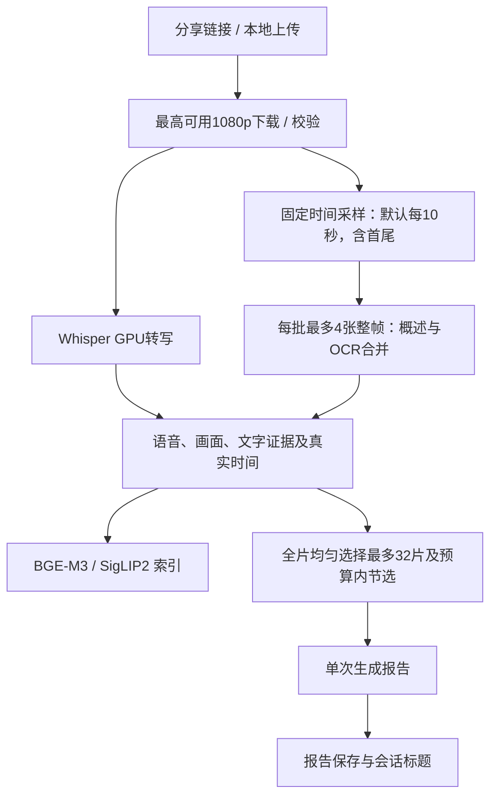
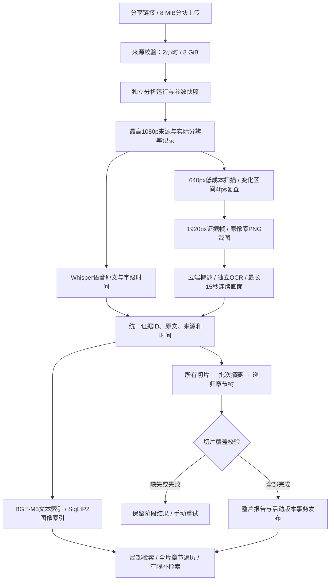

# 分析策略与资源配置

自本轮回退起，新任务使用 `fast-v3`，撤销分层章节摘要、局部变化加密采样、原像素区域裁图OCR。旧视频和已保存的报告不会自动重算；旧 `integrity-v2` 的手动恢复仍按旧快照执行。

## 当前默认链路

所有采样帧和语音原文继续保存；不再为所有切片建立章节摘要树。报告上下文采用全片均匀代表性取样，详细模式显示实际取样数量，不能将其宣称为100%全片事实覆盖。有限输入预算内会对证据进行节选，原始证据另存用于检索。

| 当前设置 | 默认值 | 配置键 |
| --- | --- | --- |
| 固定采样间隔 | 10秒，保留首尾 | `integrity.max_sample_gap_s` |
| 证据帧 | 长边1920px，JPEG质量92 | `integrity.evidence_long_side` |
| 整帧识别 | 长边1280px，每批最多4张 | `vl.max_image_side`、`vl.cloud_sequence_frames`（本链路最多4） |
| 整帧识别输出 | 2048 tokens | `integrity.ocr_tokens` |
| 单次报告 | 总预算24000、输出4096 tokens | `integrity.report_input_tokens`、`report_output_tokens` |
| 云端并发 | 总8、文本4、视觉8 | `integrity.cloud_total`、`cloud_text`、`cloud_vision` |
| 本地模型 | 三个必需模型，独立CPU/GPU设置，禁止失败降级 | 设置页模型设备选项 |

1080p、2小时/8GiB限制、分块上传、数据库版本隔离、缓存与磁盘保护、动态问答、记忆库继续保留。fast-v3问答不会自动重新启用高清裁图/局部补帧。新任务固定参数快照，修改设置只作用于之后提交的任务。

旧的扫描阈值、局部复查、OCR裁图、章节摘要批次参数只用于读取旧快照，已从新任务的网页设置区域移除。

实测数据见[回退与效率验收](回退与效率验收.md)。下面保留旧策略说明，供历史报告和手动恢复参考。

旧 integrity-v2 策略说明（已撤销作为新任务默认策略）

# 完整性分析与资源配置

新分析使用 `integrity-v2`。目标是让所有有效切片进入摘要处理链，所有已提取证据可追溯，失败、遗漏和截断可见。**切片处理覆盖率100%不等于语义信息召回率100%，也不代表逐帧观看。**

原有视频和报告直接复用，不自动下载、补帧或重建索引。选择“强制重跑”才创建新的分析运行；成功后发布，失败保留旧结果。任务接受后固定配置与提示词，修改设置只影响之后创建的分析任务。重启后已中断任务需要手动点击重试。

## 从来源到证据

语音、画面描述、OCR原文独立保存，组装时合并，避免长语音覆盖画面文字。长证据继续拆分，尾部字符保留。语音有字级时间时按真实词语时间归属；无法对齐的文字保留原语音段范围。静帧记录实际采样PTS，视频段记录请求范围和经FFprobe验证的编码时长。尾帧使用视频流真实PTS，避免音轨更长时取不到画面。

## 设置入口和默认值

网页“设置 → 分析质量与资源”集中管理质量参数，保存后新任务直接使用。源码默认值在 `configs/app_config.yaml`，个人设置在运行目录 `config/user_settings.json`。CPU/GPU与报告模式继续即时切换；云端地址、密钥、模型切换按页面提示正常重启。

| 项目 | 默认行为 | 配置键 |
| --- | --- | --- |
| 远端下载 | 最高可用1080p；横屏看高度、竖屏看宽度；低清源记录实际结果 | `media.download.format_max_height` |
| 接收限制 | 2小时、8 GiB；可调低，不能超过本版上限 | `limits.max_duration_ms`、`limits.max_file_bytes` |
| 低成本扫描 | 长边640px、1fps | `integrity.scan_long_side`、`scan_fps` |
| 基础时间覆盖 | 首尾与最长10秒间隔的采样机会 | `integrity.max_sample_gap_s` |
| 局部复查 | 变化前后各2秒、4fps；先低清复查，再取变化点与边界的高清帧 | `integrity.refine_window_s`、`refine_fps` |
| 变化阈值 | 局部像素变化0.04、边缘变化0.08；小区域变化不被全图均值淹没 | `integrity.change_threshold`、`edge_threshold` |
| 常规概述图片 | 长边1280px | `vl.max_image_side` |
| 证据帧 | 长边1920px、JPEG质量92；不使用旧200KiB强制压缩 | `integrity.evidence_long_side` |
| 文字识别 | 原视频原像素裁图、PNG；每请求最多4张、2048输出tokens | `integrity.ocr_frames`、`ocr_tokens` |
| 连续动作 | 按必要运动区间排队，窗口最长15秒，保留尾段 | `vl.video_segment_max_s`（新版执行上限15秒） |
| 摘要分批 | 目标24个切片、最多32个；先达到总预算则提前分批 | `integrity.summary_batch_target`、`summary_batch_max` |
| 本地GPU批次 | 从4起步，BGE/SigLIP最大16、Whisper最大8 | `integrity.gpu_batch_max`、`asr_batch_max` |
| 云端并发 | 总8、文本4、视觉8；问答优先，后台等待后公平推进 | `integrity.cloud_total`、`cloud_text`、`cloud_vision` |
| 临时云端错误 | 最多重试3次；429尊重Retry-After，无该字段时退避和抖动 | `integrity.cloud_retries` |
| 磁盘保护 | 默认保留5 GiB安全余量，同时检查现有帧/结果容量配额 | `integrity.disk_reserve_bytes`、`storage.limits` |

扫描与取证参数不会由模型临时扩张。调整阈值后应使用固定标注样本重新测量遗漏与重复；高运动视频不会再仅因场景密度高而合并成“每窗一帧”。新流水线也不再仅处理最前40个视频窗。

## 摘要树和独立OCR

全部有效切片按时间进入摘要批次。每条子证据都有ID，批次输出对应摘要和关键事实；数字、单位、步骤、比较、否定和明确结论需要保留。章节太长时继续递归汇总，父节点保留全部子证据和切片关联。任何切片缺少完成的摘要节点都不能通过覆盖校验。

单条证据的结构化输出仍截断时，继续拆分正文并保留原始证据ID关联。高层传递各章节概述，概述需包含关键数字、单位、比较和步骤；完整事实明细仍存放在摘要树中，不在每层重复搬运整份日志清单。全局问答读取完整事实索引，逐字相同的事实归并后保留全部来源映射。

详细报告可展开章节与事实索引、查看原始语音/画面/OCR证据，并导出Markdown。用户模式仍主要显示概览和结论；报告截断会在两种模式中明确提示。

OCR原始结果、输入区域和时间保存在运行账本；规范化的证据与检索文字另存。原文不跟随概述限制为350字或截到240字符。代码保留换行和缩进、表格保留行列，不确定内容显式标记。格式适配只接收可以明确对应输入图片的结果；不把多图缺项当作“没有文字”。真正截断时拆图或拆区域重试，结构化JSON不用普通续写拼接。

## 动态问答和预算

局部事实检索默认6条，并补充相邻切片；比较和步骤问题默认20条。全片问题先遍历章节/事实索引，必要时分批阅读全部相关材料，不能凭top-k宣称列全。证据不足时最多补检索2轮，原始问题与用户限制始终保留。有效问题最多2000字符，工作台整条消息最多8000字符。

新版证据不足时可在该运行中补帧、原像素OCR并补充索引。旧版只读已有证据。引用编号仅对应本轮实际使用的材料，刷新或后续问答不复用上一轮编号。

| 任务 | 默认总预算 | 最大输出 |
| --- | ---: | ---: |
| 标题 | 精简报告摘要 | 100 tokens，最多15字符 |
| 画面概述 | 单次不超过8张常规帧；当前逐帧独立处理 | 512 tokens |
| OCR | 每批最多4张原像素裁图 | 2048 tokens |
| 证据批次/章节 | 12000 tokens | 2048 tokens |
| 最终报告 | 24000 tokens | 4096 tokens |
| 局部问答 | 8000 tokens | 2048 tokens |
| 全局比较/汇总 | 24000 tokens | 4096 tokens |

总预算包含提示词、历史、证据、输出预留与安全余量。应用按UTF-8字节数保守估算，不下载额外tokenizer，不将估算宣称为服务商实际tokens。实际用量、结束原因和请求状态单独保存。结构化摘要被截断时缩小批次；普通报告/回答最多续写2次，仍未完成会标记截断。

请求数默认达到200次预警，预警不会静默丢弃证据。价格未配置时只显示请求数与tokens；设置每百万输入/输出单价后提供估算费用。失败请求可能仍由服务商计费，未返回usage的请求无法得到准确token费用。

## 续传与恢复

选中文件仅预览，点击发送才创建会话并启动上传。网页在Worker中增量计算完整SHA-256，每次只读8 MiB；服务端逐块校验，分块可以幂等重传。完成时流式校验完整哈希和FFprobe信息，随后返回原附件结构。

断网自动重试当前块。刷新后重新选择同一文件、发送，校验后复用原会话和已接收块；未完成上传按最后活动时间保留24小时。原流式上传入口继续兼容。校验不符、缺块、超时长或空间不足都会明确停止，不接受不完整文件。

同一会话只处理一个操作。云端结果按模型、输入证据、参数和提示词版本缓存；手动恢复只补未完成部分。进程重启不会静默恢复调用云端。所有验证结果及其局限见[验收记录](完整性升级验收记录.md)。

