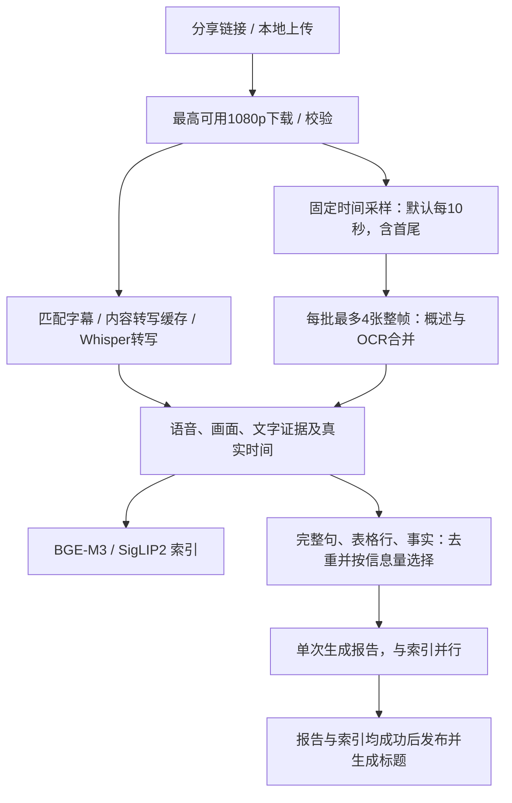

# 分析策略与资源配置

当前新任务使用 `fast-v4`，删除新分析中的镜头检测，保持撤销分层章节摘要、局部变化加密采样、原像素区域裁图OCR。旧视频和已保存的报告不会自动重算；旧任务手动恢复仍按原快照执行。

## 当前默认链路

所有采样帧和语音原文继续保存；不为所有切片建立章节摘要树。报告上下文在时间/来源保底后，按关键词、数字、比较关系与限制条件评分选择完整单元，不截字符串前缀。重复OCR正文只输入一次，全部时间关联另存。详细模式显示入选/遗漏数量，不能将关联到切片宣称为100%全片事实覆盖。超预算单元原文另存用于检索。

| 当前设置 | 默认值 | 配置键 |
| --- | --- | --- |
| 固定采样间隔 | 10秒，保留首尾 | `integrity.max_sample_gap_s` |
| 证据帧 | 长边1920px，JPEG质量92 | `integrity.evidence_long_side` |
| 整帧识别 | 长边1280px，每批最多4张 | `vl.max_image_side`、`vl.cloud_sequence_frames`（本链路最多4） |
| 整帧识别输出 | 2048 tokens | `integrity.ocr_tokens` |
| 单次报告 | 总预算24000、输出4096 tokens | `integrity.report_input_tokens`、`report_output_tokens` |
| 云端并发 | 总8、文本4、视觉8 | `integrity.cloud_total`、`cloud_text`、`cloud_vision` |
| 本地模型 | 三个必需模型，独立CPU/GPU设置，禁止失败降级 | 设置页模型设备选项 |

1080p、2小时/8GiB限制、分块上传、数据库版本隔离、缓存与磁盘保护、动态问答、记忆库继续保留。fast-v4问答不会自动重新启用高清裁图/局部补帧。新任务固定参数快照，修改设置只作用于之后提交的任务。

旧的扫描阈值、局部复查、OCR裁图、章节摘要批次参数只用于读取旧快照，已从新任务的网页设置区域移除。

实现原理见[并行分析与完整事实打包](并行分析与完整事实打包.md)，实测数据见[并行分析验收](../更新日志/2026-11-01并行分析验收.md)，前一版见[历史回退验收](../更新日志/回退与效率验收.md)。旧策略独立保存在[历史完整性策略](../更新日志/历史完整性策略.md)，仅供历史报告和手动恢复参考。
