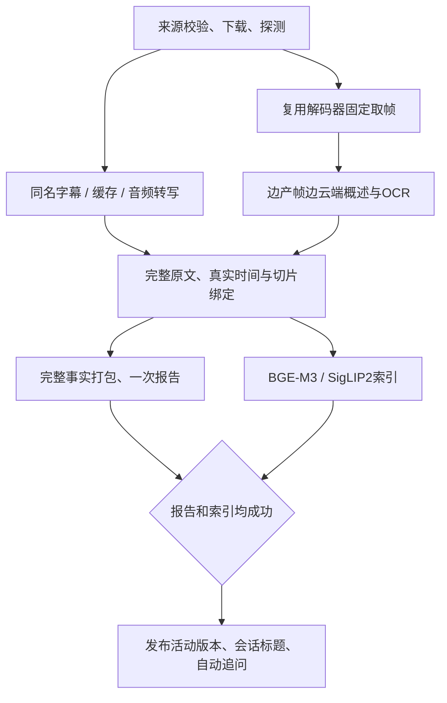

# 并行分析与完整事实打包

当前新分析版本：`fast-v4`。保留原有本地模型、云端配置、1080p和固定采样间隔，重点删除无效工作、重叠等待，并在同一报告预算内保留更完整的事实。

## 实施范围

1. **新分析移除镜头检测**：不装配检测器，不生成镜头检测阶段，移除 `scenedetect` 依赖。固定每10秒采样及首尾采样保留。旧快照兼容代码与旧历史字段仍保留，不对已有视频重算或清空镜头记录。
2. **字幕与转写复用**：优先匹配当前视频同名字幕或同名语言后缀字幕，不读取同目录其他视频的字幕；本地软链接可查找原视频旁的字幕。无有效匹配时，依次复用当前运行检查点、音频内容缓存，再运行Whisper。字幕为空或时间越出视频范围时不使用。内容缓存同时校验音频SHA-256、ASR参数、模型目录及权重文件大小/修改时间；不因为缓存而切换设备或模型。
3. **流式解码和识别**：使用有界的PyAV解码器池，按时间定位且复用上下文，不再为每张图片新建FFmpeg进程。保存请求时间和实际帧PTS；旋转按显示方向处理。有界队列边产帧边识别，批量整帧概述/OCR与转写同时进行，稍后绑定文字切片。失败收尾等待解码/识别线程退出，不让后台继续写入失败版本。
4. **网络与图片复用**：每次分析复用文本/视觉HTTP连接池，保留TLS校验、系统代理、NO_PROXY、HTTP状态及Retry-After语义；连接池随该次分析关闭。图片编码按路径、修改时间、大小和缩放参数缓存。成功视觉批次立即持久化，另一批失败时不丢失已经完成的帧。
5. **报告与索引并行**：视觉和转写证据准备好后，两支同时执行。两者全部成功才发布活动版本；一支失败保留旧版本。原始证据继续全部参与索引，报告选择不会删掉未采用的原文。
6. **完整事实打包**：完整句子、表格行及表头、代码块作为输入单元，不将字符串前缀冒充完整事实。超大单元放不进预算时记录遗漏，原文仍保存。相同类型且逐字相同的单元只输入一次，全部源证据、切片和出现时间保存到关联清单；不把近似但数字不同的OCR误合并。
7. **信息量预算**：语音/画面/OCR、首尾和时间分布保底，其余按轻量关键词、型号、数字、价格、日期、单位、步骤、限制与比较关系评分选择。报告不再硬限32个切片，也不会为了增加数量而截断单元。标题、报告、问答仍使用各自应用预算；报告总预算24000、输出4096 tokens没有降低。
8. **复用现有关键词与BGE**：默认仍采用jieba与词频/逆文档频率式评分。已实现有界TF-IDF/TextRank实验模型，但未证明开启后云端报告不降速，因此默认关闭，不部署额外神经网络权重；详见[轻量关键词辅助](轻量关键词辅助.md)。已有索引向量可产生轻量BGE中心相似度；仅关键词不足且分数已可用时辅助选择。报告线程不等待BGE评分，不增加GPU编码。是否启用语义辅助由本次输入及已就绪分数决定。

报告提示词在 `configs/prompts.yaml` 的 `integrity_fast_report` 中，接受任务时随参数固定。概览简短，主要脉络用紧凑表格承载事实，结论避免重复整组数据；比较百分比保留主体、基准和方向，不把“低x%”倒换成“高x%”。这些约束降低模型误写概率，不能代替原始证据校对。

## 工作流程与持久化

运行目录仍是源码同级的 `VideoLens-runtime/`：

| 路径/记录 | 用途 |
| --- | --- |
| `data/transcripts/<指纹>.json` | 转写原文、词级时间、ASR/权重身份与共享视频所有者；删除视频只移除自身关联 |
| `data/analysis-runs/<run_id>/frames/*.time.json` | 请求采样时间与实际PTS |
| `data/analysis-runs/<run_id>/evidence.sqlite3` | 原始证据、请求缓存、调用使用量和阶段状态 |
| `results.report_selection` | 预算选择、入选/遗漏数量及关键词 |
| `results.report_provenance` | 完整单元、全部出现时间、证据ID及是否入选 |
| `results.completed_frames-*` | 已成功识别的帧，手动恢复不重跑成功帧 |

详细视图展示完整单元的入选/遗漏数量、关联切片数、实际分辨率、转写复用和云端使用量。用户模式仍只展示概览与结论。

## 验证与测量

标准视频实测、质量边界与回归结果独立保存在[2026-11-01并行分析验收](../更新日志/2026-11-01并行分析验收.md)。复现方法见[测试与维护](测试与维护.md)，当前控制台计时说明见[日志文件与格式](../功能介绍/日志文件与格式.md)。
