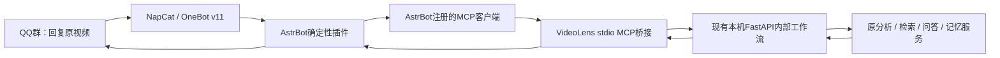

# 本地 MCP 接入

可选接入代码位于 `integrations/`，与FastAPI网页和分析流水线分离。MCP只采用stdio，不新增对外监听端口；桥接只允许访问本机HTTP根地址，不暴露文件读写、命令执行、密钥配置或视频删除工具。



## 工具与长任务

| MCP工具 | 行为 |
| --- | --- |
| `videolens_status` | 检查本机服务及实际模型设备，不返回密钥 |
| `videolens_analyze` | 仅接收Bilibili视频/短链接，提交分析并立即返回任务；已有报告可复用 |
| `videolens_ask` | 在已存在的桥接会话里提交追问 |
| `videolens_result` | 查询桥接自己创建的任务，返回进度及报告/回答Markdown |

插件使用已注册的AstrBot MCP客户端，不绕过MCP直接调用Python分析器。长分析由后端持久化执行，插件通过短调用轮询，避免把长视频耗时塞进一次MCP工具超时。插件等待超时不取消后端；服务中断不静默重放已接受的云端分析。

MCP环境只需要 `integrations/requirements-mcp.txt` 中的SDK。AstrBot环境已有相应依赖，可以用绝对Python路径启动，VideoLens的模型环境无需加装AstrBot依赖。

桥接库只保存会话映射和任务终态，不另存报告/问答正文；读取结果仍检查原业务会话是否存在。视频和会话被网页删除后，不会从旧MCP报告缓存恢复已删除的正文。

## 消息门控

插件只处理OneBot群消息。先检查允许群、引用ID和当前消息文字；首次必须有“视频分析”关键词。随后通过 `get_msg` 读取引用的原消息，从文本及JSON卡片中提取实际Bilibili候选；合并转发只按有界的一层展开。原消息不含一个明确来源时不调用模型猜测URL。

同一群的同一视频消息只允许一项操作执行；QQ消息ID和后端请求ID共同防止重复上报重复分析。群和原消息关联共用视频报告，用户ID进入会话键，避免群友之间互串多轮上下文。后续问题仍必须回复原视频；回复机器人报告不沿引用链偷偷转成视频任务。

## 自测与常规运行

NapCat上报本账号发送内容时使用 `message_sent`，AstrBot普通OneBot适配器只消费群友的 `message`。临时自测前缀启用时，插件订阅 `message_sent`，仅对指定群、本人账号、匹配前缀的消息转入同一AstrBot处理流程。普通输出不带该前缀，不会递归触发。

插件重载/关闭时注销自测订阅；日常清空前缀并关闭自身消息上报。事件停止放在所有回复yield完成之后，否则AstrBot可能在“已收到”之后中止生成器，导致MCP未执行。

## 验证

```bash
# 原VideoLens环境中的纯桥接和消息格式回归
python tests/test_mcp_bridge.py
```

```bash
# 独立AstrBot环境：使用真实AstrBot SDK验证插件行为
conda activate D:/Environment/AstrBot
export PYTHONPATH="D:/Project/AstrBot"
export PYTHONPYCACHEPREFIX="D:/Project/vl/VideoLens-runtime/cache/pycache"
python tests/test_astrbot_reply.py
```

SDK回归使用MCP替身，真实stdio握手、实际QQ群消息与云端结果独立记录，见[接入验收](../更新日志/2026-11-02AstrBot接入验收.md)。本机配置、登录状态和测试消息数据不进入源码仓库。

## QQ图片和卡片输出

MCP继续返回原始Markdown，展示格式由AstrBot插件负责。默认图片路径为：Markdown → 本地`MarkdownRenderer` → 按空白行优先分页 → 读取图片字节 → `Image.fromBytes` → OneBot适配器的`image`消息段。图片消息带`Reply`指向原视频；显式关闭该消息的二次转图和Markdown发送标记，避免受全局展示配置干扰。短状态提示仍走文字，结果图片失败会报错，不自动用Markdown原文替代。

Bilibili分享使用另一条独立路径：读取公开视频标题/封面 → NapCat `get_mini_app_ark` → 校验小程序应用、视图、封面和跳转目标 → `json`消息段。JSON必须放在消息组件内，不能通过`Plain`或字符串转义成聊天文字。旧的`notification`简化视图会被拒绝。

`tests/test_astrbot_reply.py`使用真实AstrBot渲染器和OneBot序列化实现，发送端用替身代替，不连接QQ群。`tests/test_qq_card.py`将HTTP替换为内存响应，检查发出的消息段类型；`tests/test_astrbot_install.py`只对临时目录操作。上述离线检查不代表QQ客户端实际收到了新图片。

源码同步与手动重载方法见[QQ接入使用说明](../功能介绍/AstrBot与QQ视频分析.md)。
