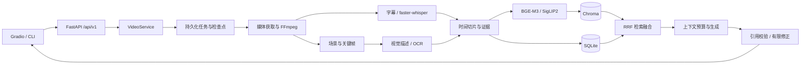
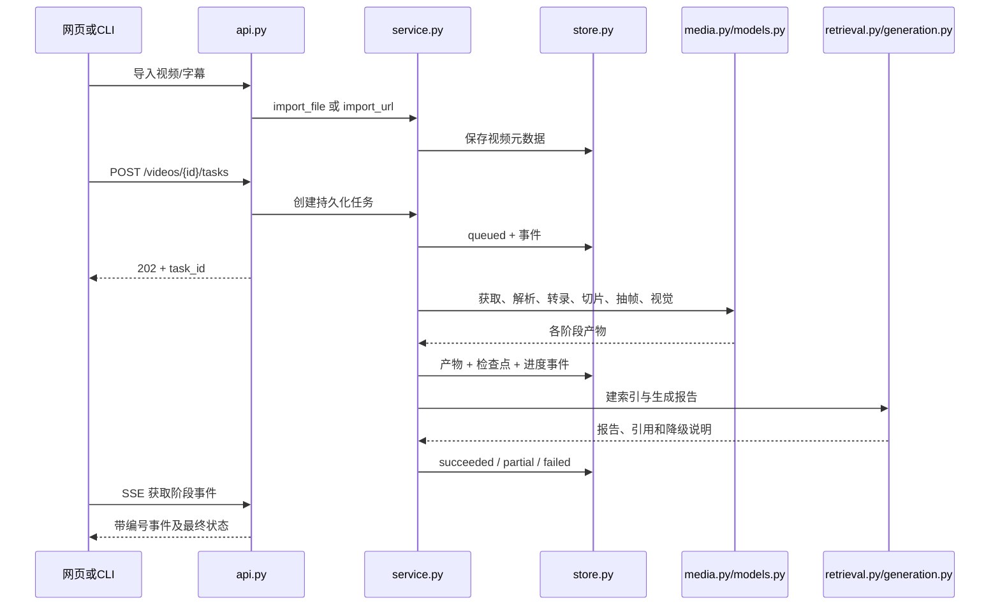

# 架构与代码导读

## 1. 从输入到答案

视频同时包含声音与画面。知影先把声音转为带时间的文字，再把关键画面转为图片证据和描述，两条通道在“切片”处合并。检索找到相关切片后，模型只根据这些证据回答。



SQLite 是事实记录：保存哪个视频、哪个任务、哪条字幕、哪一帧、哪个会话。Chroma 保存数值向量，是为了更快找到语义相近的内容；向量可以从 SQLite 与原始证据重新生成，因此它是派生数据。

## 2. 一次分析请求经过哪些代码



### 接入层

`api.create_app` 构建 FastAPI 应用并注册生命周期。路由解析输入、校验鉴权、选择响应格式，具体分析交给业务服务。`api.save_upload` 使用分块读取保存上传文件，避免 4GB 视频一次进入内存；超限时明确失败。CLI 通过 HTTP 调用同一接口，不另写一份分析流程。

`ui.ApiClient` 是网页后端请求 API 的小封装，登录后的媒体代理用于播放视频与展示帧。浏览器不需要获取云端 API Key。

### 任务与检查点

`service.VideoService` 负责业务协调。任务记录先进入 SQLite，再由后台工作线程执行。每完成一个阶段，把阶段产物和检查点写入数据库；重启时通过检查点决定从哪一步继续。

“幂等”可以理解为：同一个阶段重复执行两次，最终数据库仍只有同一组切片，而不是重复两份。任务先在自己独立的目录写帧，并建立未发布的 Chroma 集合。最终 `Database.commit_analysis` 在一个 SQLite 事务中发布视频报告、切片、帧及索引指针；主键包含视频 ID 和产物 ID，检查点主键包含任务 ID 和阶段名。失败任务不会把旧报告指向新的半成品帧。

`Settings.fingerprint` 同时包含设置与已安装模型的 revision/文件 SHA 摘要。同名模型升级后旧检查点失效；配置默认值经过类型校验，避免 `20` 和 `20.0` 仅因 JSON 往返就被误判为版本变化。`IndexManager.search` 也核对构建时的权重版本，不把不同版本的向量空间混用。

暂停、取消属于控制信号，不能被普通模型错误的降级处理吞掉。`errors.TaskInterrupted` 与模型层的中断传播用于把用户操作传回任务编排器。外部命令使用受管子进程，不按名称结束其他程序。

### 媒体解析与字幕

`media.probe` 调 FFprobe 读取真实媒体流、时长与尺寸。不能只根据 `.mp4` 扩展名判断文件一定能播放。`extract_audio` 调 FFmpeg 生成 16kHz 单声道音频，后续 ASR 读取此音频。

`read_subtitles` 解析 SRT、VTT、ASS，统一为开始毫秒、结束毫秒和文本。`find_subtitles` 优先查找可用字幕轨，缺失时才进入 ASR。字幕和模型转录都转换成相同结构，因此切片逻辑无需关心文本来自哪一种来源。

`make_clips` 按目标长度、最大长度与句子边界组织文本；无语音时仍根据视频时间生成切片。这里所有时间都使用整数毫秒：例如 1.5 秒写成 `1500`，导出时再变成 `00:00:01.500`。

`extract_frames` 优先场景变化点，再均匀补采样。图片压缩以可读性和最大字节目标为依据；每帧记录实际时间和尺寸。重复画面可以去重，不保证强行凑够数量。画面描述及 OCR 只关联对应帧 ID，不凭空创建无来源证据。

### 模型生命周期

`models.ModelGateway` 为不同模型提供统一入口：`transcribe`、`embed_texts`、`embed_images`、`embed_image_query`、`describe`、`generate`、`stream`。模型优先从部署清单的固定 snapshot 目录加载；一个阶段完成后可以释放重型模型，减少显存峰值。

GPU 是否可用不能仅看电脑有独立显卡。ASR 的 CTranslate2 与向量模型的 PyTorch 使用不同运行时，需要分别做真实推理。`device=auto` 可以尝试 GPU 后回退 CPU，并记录回退原因。

云端适配器负责请求、超时与 SSE 解析。SSE 是一串以空行分隔的事件，网络收到的一块字节可能只包含半条事件，因此不能把每个网络块直接当作完整 JSON。模型流需要识别真正的结束条件；断流不等于成功。

## 3. 一次追问如何形成有证据的回答

1. API 接收会话 ID 与问题，通过会话找所属视频，并读取最近消息。
2. `IndexManager.search` 获得文本向量、图文向量和关键词三组候选，并映射到切片 ID。
3. `fuse_rankings` 使用加权 RRF 融合，选出最相关切片；`clip_refs` 回填字幕和帧证据。
4. `VideoService._conversation` 选出检索时间段对应的章节，再由 `Composer._messages` 组合系统规则、历史摘要、近期消息、本轮问题、章节摘要与原始证据，同时保留输出预算。
5. `Composer.compose` 请求结构化回答。文本云端不可用时可以转本地 llama.cpp。
6. `validate_claims` 检查每条结论是否引用提供过的证据，以及附带摘录是否属于原始文本。引用内容由后端回填，模型不能自行改写证据原文。
7. 格式或引用错误时进行一次有限修正；仍不可用时退回原文摘录或证据不足说明。
8. 将问题、最终答案与引用保存到所属会话，并发送完成事件。

### RRF 为什么不直接使用相似度相加

向量 A 的 `0.8` 和向量 B 的 `0.8` 不一定具有同等含义，关键词分数又使用另一种量纲。RRF 只使用排名：

```text
某切片得分 = Σ(可用通道权重 / (60 + 该通道中的名次))
```

名次从 1 开始。文本、图文、关键词默认权重分别为 0.5、0.3、0.2；某一路不可用时重新归一化剩余权重。重复候选先去重，避免同一个切片因为帧较多获得不合理加分。

### 上下文预算与长视频

模型一次能接收的文本有限。`Composer._messages` 按实际序列化后的消息字节数选择证据，为生成结果和消息包装保留输出空间与安全余量。实现采用 UTF-8 字节数作为未知分词器下的保守上界，因此预算可能比供应商标称上下文更紧，但不会假装知道每个模型的精确 tokenizer。配置拒绝输出预算大于启用模型窗口的组合。

长视频按默认 5 分钟建立章节内容，使用章节概览、相关切片与原始证据组合，避免一次发送两小时全部文本。历史会话保留近期消息，并压缩更早的背景。上下文剪裁不能删除引用校验所需的原始证据关联。

章节结论保存为 `claims`。进入上下文时，每条摘要和其 `source_refs` 对应的全部原文一起加入；预算容纳不下就整条跳过，不留下没有原文支撑的摘要。全文总结优先覆盖首尾和中间章节；追问只引入检索相关的少量章节，留出问题证据预算。

## 4. 数据结构与恢复

| SQLite 表 | 保存内容 | 恢复时的作用 |
|---|---|---|
| `videos` | 视频 ID、来源、元信息、报告和状态 | 找回视频与已完成结果 |
| `jobs` | 任务 ID、视频 ID、阶段、状态、错误 | 重新调度未结束任务 |
| `clips` | 切片 ID、时间范围、转录文本 | 关键词检索和证据回填 |
| `frames` | 帧 ID、时间、受管路径、视觉文本 | 画面展示、图像检索和 OCR 证据 |
| `checkpoints` | 每任务每阶段的完成信息 | 跳过已成功且兼容的阶段 |
| `events` | 自增编号的任务事件 | SSE 断线从最后编号继续 |
| `sessions` / `messages` | 会话归属与消息 | 重启后继续同一视频问答 |
| `metadata` | 索引版本等业务元信息 | 找到当前可用的派生索引 |

`Database.connect` 为每次操作提供连接，成功提交、异常回滚、最后关闭。WAL 模式允许网页读取和后台写入更好地并发。查询参数使用绑定参数，避免把用户输入拼成 SQL。

索引重建先创建新版本，成功后切换当前版本指针。分析新一代产物时，先准备好 Chroma 集合，再由 SQLite 事务统一发布业务记录和集合指针；独立重建失败时保留原活动索引。不能把“数据库写入成功”当成“所有向量也写入成功”。清理会保留当前证据引用的帧，超过保留期的失败中间文件及旧代帧可以重做，因此可删除。所有删除限定在受管理路径，原始文件属于用户，不参与自动删除。

API 流式问答为每条流分配固定工作线程，生成器的 `next()` 与 `close()` 在同一线程执行。原因是业务层在生成期间持有可重入锁：若通用线程池在不同线程推进生成器，回答结束后会发生锁所有权错误。真正的模型增量标为草稿，最终事件才携带完成引用校验的回答。

## 5. 部署代码细节

`bootstrap.download_models` 从固定 revision 下载模型，并核对上游大文件 SHA-256，记录每个文件的大小和本地 SHA。`verify_models` 离线重算完整性；这只证明文件没有损坏，不证明识别质量。

`bootstrap.download_file` 流式下载到 `.part` 临时文件，支持 Range 续传。服务器忽略 Range 时重新写入而非错误追加。只有哈希完全一致才替换正式文件。运行时解压前拒绝目录穿越、绝对路径和符号链接。

`start_local` 先检查回环端口是否空闲，启动指定 llama-server，再轮询 `/health`。进程记录包含 PID、创建时间、可执行文件、模型路径和启动者标识。`stop_local` 必须匹配这些身份，防止 PID 被系统重复使用后误停其他进程。`--version`、健康检查和真实生成是三个不同级别的验证。

## 6. 阅读源码的建议顺序

从 `config.py` 和 `errors.py` 开始，理解输入与错误；接着阅读 `store.py` 了解数据，再看 `media.py` 理解证据如何产生。然后阅读 `models.py`、`retrieval.py` 和 `generation.py`，最后看 `service.py` 如何串联它们，以及 `api.py`、`ui.py`、`cli.py` 如何提供入口。

每个函数重点看四件事：接收什么输入、返回什么、什么时候可能失败、失败后谁负责处理。关键注释解释“为什么这样做”，例如防止重复任务、避免半个 JSON、释放显存和保护原始视频；不需要把每行代码都翻译成中文才能理解整体流程。
